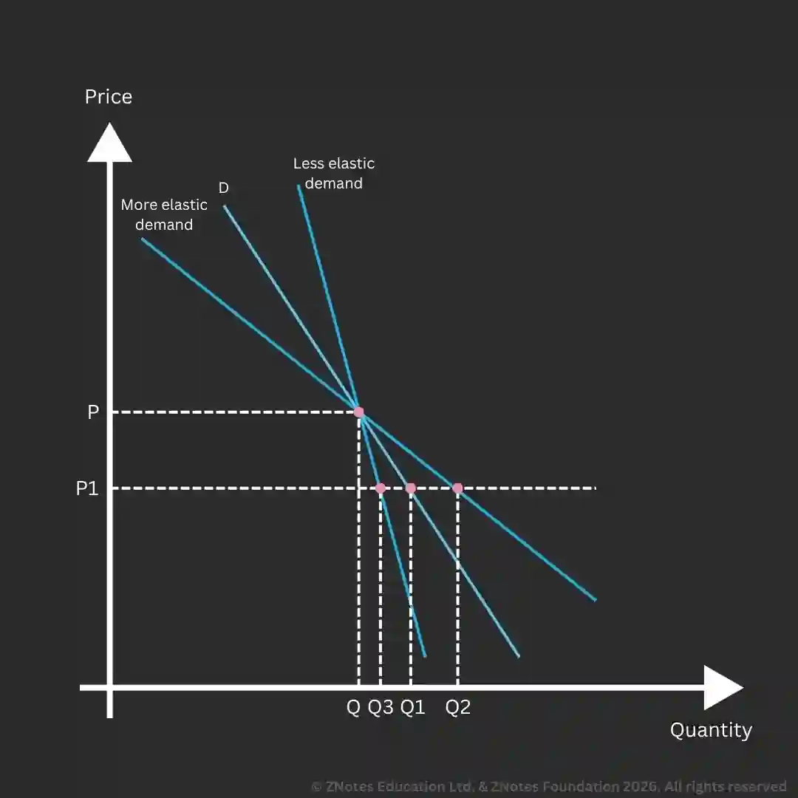

## Price Elasticity of Demand

* **Price elasticity of demand** is the responsiveness of demand following a price change.
* $\text{PED} = \frac{\text{Percentage change in Quantity Demanded}}{\text{Percentage change in Price}} \\$
* $\text{Percentage Change} = \frac{\text{New Value} - \text{Original Value}}{\text{Original Value}} \times 100$
* If a negative value is received, do not take the minus sign into account. For example, if the calculation yields -2.5, the value would be elastic as we only take 2.5 into account.
* **Inelastic demand** is when a change in price results in a proportionately smaller change in demand.
  * E.g., A 15% Rise in price would result in a 10% fall in demand.

  * PED would be ++less than 1++ in this case.
* **Elastic demand** is when a change in price results in a proportionately larger change in demand.
  * E.g., A 10% rise in price would result in a 20% decrease in demand.

  * PED would be ++more than 1++ in this case

#|
||

Price Elasticity

|

Value of Elasticity

|

Price change

|

Effect on revenue

||
||

Inelastic

|

\<1

|

Decrease

|

Fall

||
||

Inelastic

|

\<1

|

Increase

|

Rise

||
||

Elastic

|

> 1

|

Decrease

|

Rise

||
||

Elastic

|

> 1

|

Increase

|

Fall

||
|#

### Factors influencing PED

* **Time**: Price elasticity tends to rise in a longer time period (become more elastic) as the consumers are likely to turn to substitutes in the long run.

* **Competition for the same products**: products that have identical or slightly different competitors tend to have a high price elasticity of demand (Elastic if too many substitutes are present). E.g., farmers.

* **Branding**: the stronger the branding, the lower the price elasticity of demand (inelastic if branding is strong), as consumers are not likely to accept the substitutes or cheaper alternatives.

* **Proportion of income spent on a product**: products that occupy a small portion of a consumer's income tend to be price inelastic.

* **Product type vs the product of an individual business**: most products are sold by a number of different firms. Products like petrol tend to have a lower price elasticity of demand than products within that category made by an individual business.

### Graphical Representation

* The steeper the line, the more elastic the demand is.