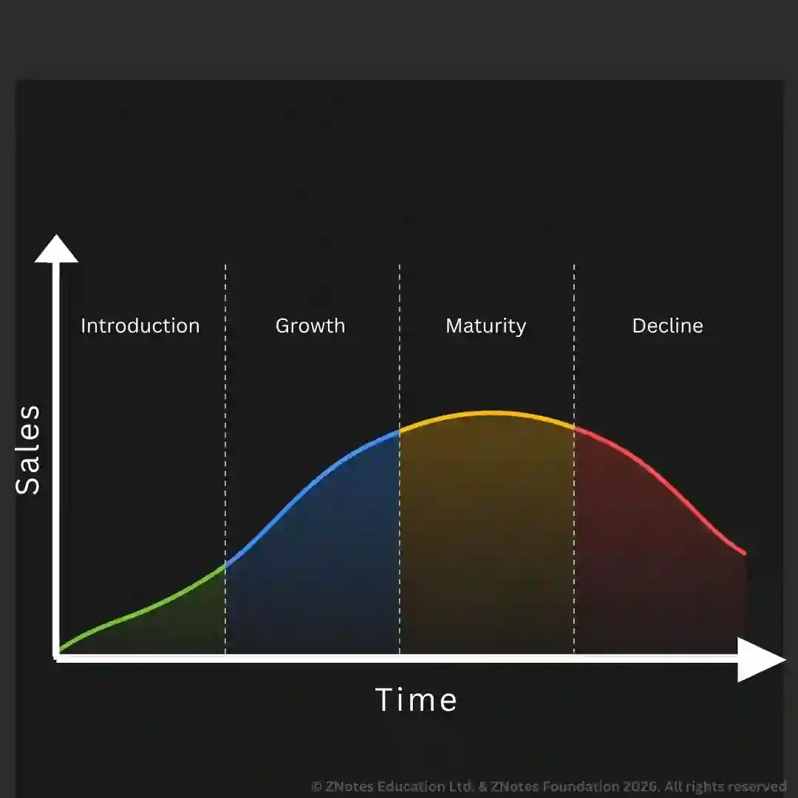
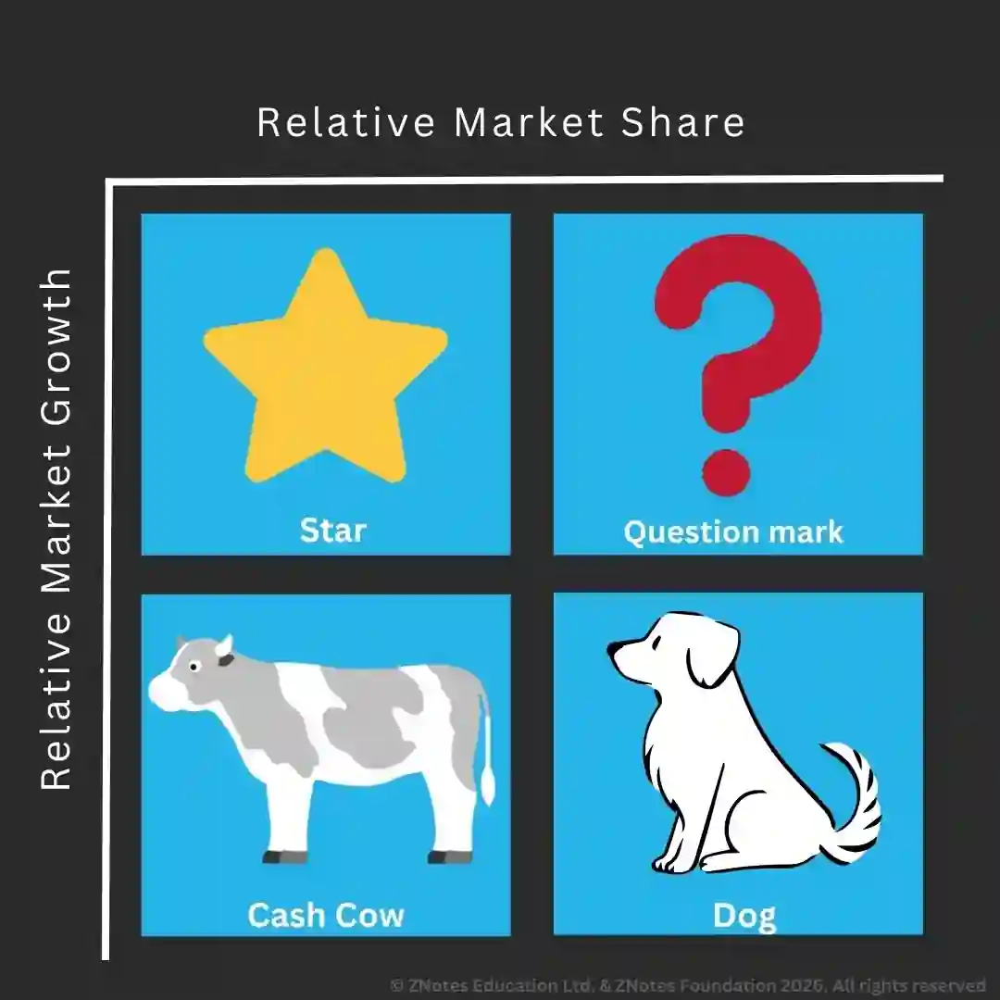

# Marketing Mix and Strategy

## Marketing Objectives and Strategy

**Marketing objectives are set:**

* **To make marketing activities more effective and efficient.**

* **To increase market share**: A business prefers to have a large market share because it allows the firm to gain a competitive edge. It also helps exploit economies of scale, which helps lower costs. To do this, a firm has to invest in an advertising campaign or adjust its pricing.

* **To increase revenue**: This can be done by online advertising, sponsoring, etc., to boost revenue, which can lead to an increase in profit.

* **To build a brand**: A strong brand can help generate huge returns for a company. This helps the firm to get a USP and a competitive advantage. A business is more likely to achieve this by using SMART marketing.

### Product Life Cycle

* **Development**: The product is being researched and implemented at this stage. A prototype may be produced to test. There will be no revenue at this stage, but the firm will continue to spend.

* **Introduction**: The product is launched at this stage, where the initial revenue is low. The firm may construct a production plant and will also have to meet promotion and distribution costs. The product may have a high price to cover costs or a low cost to penetrate a market.

* **Growth**: Unit costs fall as production increases and the product becomes profitable. Competitors may launch their own version, causing profit growth to slow down. Hence, the firm has to consider marketing and promotion.

* **Maturity and Saturation**: The growth of sales reaches its maximum point. Competitors will have also entered the market, causing some firms to be forced out and the market to become saturated.

* **Decline**: Sales eventually decline for the majority of products. This happens due to changing customer tastes, new tech, or new products. The product may be withdrawn or sold to another firm. Profit may also be made by increasing the price and lowering spending on promotion.

**Extension Strategies**

* **Product adjustments:**

  * Updating, remodeling the features of the product.

  * Add value by making improvements, extra features, and functions.

  * Extending the product range: new flavors and designs.

  * Impression of modification: changing packaging.

* **Promotion**:

  * Finding new uses for products.

  * New markets for products.

  * Investing in an advertising campaign.

  * Encourage frequent use of the product.

### Product Portfolio and Boston Matrix

* A product portfolio is a collection of products and services sold by a business. A product portfolio can help show the release of a product over time.

* Boston Matrix is a technique that is used to categorize product portfolios. Products are categorized by:

  * **Market growth**: The sales of a product in a fast-expanding market. A business has a better chance of growing.

  * **Relative market share**: The strength of a product in a market. The market share is compared to the strongest rival to measure.

* **4 categories of the Boston Matrix:**

* **Stars**: A product with a high market share and high market growth. A business has to invest in the product, even if it is already profitable. Net cash flow may be zero as inflow (profit) and outflow (investment) cancel out.

* **Cash Cows**: A product with a high market share and little need for investment. The market where a cash cow is sold tends to have low growth. They will have a strong positive net cash flow.

* **Question Marks**: Products with a relatively low market share in a fast-growing market. These products have the potential to be turned into a star as it is in a fast-growing market. These products are not profitable, but investment will be needed for expansion. Hence, cash flow is likely to be zero or negative.

* **Dogs**: Products with a relatively low market share in a slow/low-growing market. Dogs have poor prospects for sales and profits. They may make little profit as little investment is needed, but some profit can be earned. Net cash flow may be zero or negative.

**Balancing Product Lines**

* Businesses must not contain too many products in the same category. Avoid high costs due to promotion investments.

* The question marks have a chance of turning into stars and cash cows.

* Taking Appropriate Decisions

  * Stars may become cash cows. Hence, firms need to build up sales and fight off competitors.

  * Cash cows are kept for cash and promoted just enough to maintain market share and sales.

  * Question marks can be turned into brands, harvested (make a profit), or withdrawn.

  * Dogs are divested if no profit is made or it is harvested until it remains profitable.

### Marketing Mix

* **The marketing mix:** a combination of product, price, place and promotion used by a business to promote its products effectively to customers.

  * **Product**: Consumers' needs must be met. It is concerned with the appearance of the product, its life cycle, its unique selling points, etc.

  * **Price**: Pricing policies have to be set to maximize sales or short-term profits. Costs and taxes must be considered.

  * **Promotion**: Consumers must be given information about the product and be encouraged to buy it. Businesses can promote using advertisements in magazines or sponsorships, coupons, etc.

  * **Place**: Products must be available to consumers at a convenient time and place. Internally, firms have to make decisions on how the product is sold, where the product is sold, and how it is distributed physically.

### Marketing Strategies

* Strategies are decided by analyzing the business objectives. Some examples of strategies could include:

  * Improving the quality of customer service.

  * Half-price deal to previous consumers.

  * Discounts.

  * Investment in advertising.

  * Donations to get PR.

  * Website.

**Strategies for Mass Market**

* Provides a mass medium since these products have many competitors for consumer attention.

* Develop a USP.

* Competitors force businesses to sell at a lower price. If a firm sells at a lower price, it is likely to gain the majority of customers.

* Firms use a mass campaign, investing heavily in promotion and advertising to attract customers.

* Firms sell in as many channels as possible, including distributors, supermarkets, wholesalers, etc. Some firms may pay for prominent display in supermarkets. Internet sales increase the mass market.

**Strategies for Niche Markets**

* Products are likely to have a significant difference from rival products and are designed very carefully to meet the exact needs of consumers. Products are usually premium-priced.

* Less competition allows higher prices to be charged without losing market share.

* Businesses need to analyze consumers' profiles carefully to avoid waste of resources in order to target adverts successfully.

* Businesses need to use more selective marketing as small markets have less need for advertising. Internet sales can be used as a distribution method.

**Strategies for B2B and B2C markets**

* **Outbound marketing strategies**: involve directing marketing material at potential consumers. This includes emails, phone calls, sponsorships, and targeted advertisements.

  * People can get annoyed and ignore ads.

  * Waste of resources.

  * High costs.

* **Inbound marketing**: involves attracting consumers to a website when they are looking for a solution or supplier. Techniques include blogging, social media, targeted emails, ebooks, search engine optimization, videos, etc.

  * Effort and resources to build useful content on websites.

  * Difficulty in recruiting experienced inbound marketers.

  * Tricky to keep up the strategy with rapidly changing trends.

* **Hybrid strategies**: Outbound methods are used to generate results in the short term (around 6 months). The inbound methods are adopted after meaningful leads are generated.

  * Reduce costs.

  * Sustainable growth in market share.

### How a Business Develops Customer Loyalty

* **Communication**: Regular communication helps build customer relationships, which increases the chances of customers returning. This can be done by using reassuring advertisements, regular newsletters, and advertising of new products, etc.

* **Customer service**: Customers are more likely to return after receiving high-quality service. Quality service can be done by training employees to be professional and reliable, dealing with matters promptly, and making the purchasing experience more pleasant.

* **Customer incentives**: Many firms reward customers with repeat purchases. This is usually done by linking rewards and values to the amount spent.

* **Personalization**: Some firms deal with customers on a personal level by using the consumer's name in emails, birthday messages, etc., to build a strong relationship. This is preferred by small businesses rather than multinationals.

* **Preferential treatment**: A business providing preferential treatment has a higher chance of consumers returning. This occurs in places like business and first-class lounges.