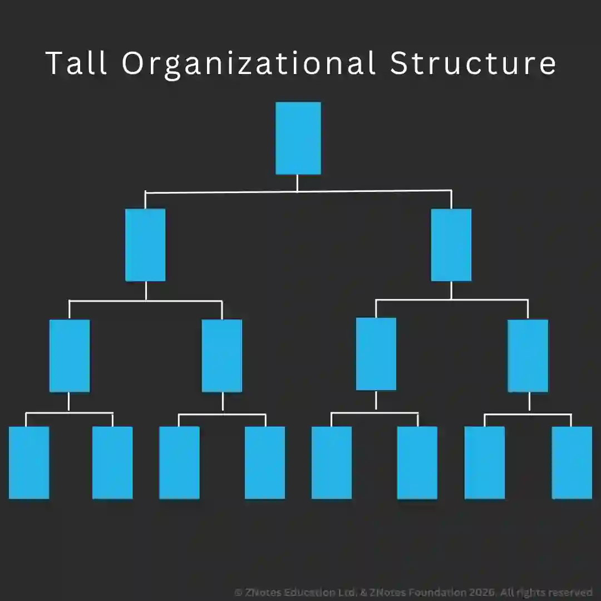
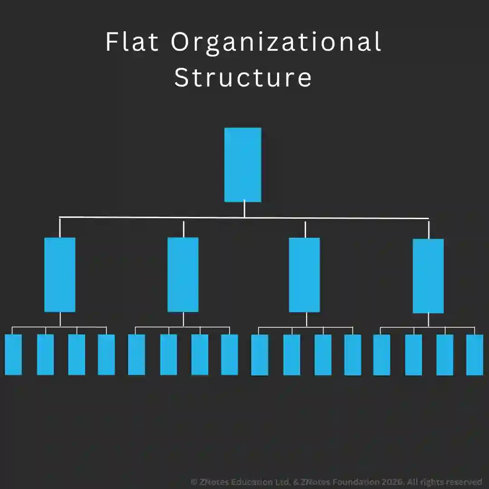

## Organisational design

**Organisational structure defines:**

* Workforce roles of employees and their job titles.

* Routes through which decisions are made.

* Who is responsible and accountable for who and what activities.

* Relationship between positions in a business.

* How employees communicate with each other and how information is passed on.

### Key Components of Organisational Structures

**Hierarchy**

* An organisational chart illustrates the structure of a business and shows:

  * How the business is split.

  * Roles of employees and their job titles.

  * Who has responsibility

  * To whom are people accountable.

  * Communication channels.

  * Relationships between different positions in a business.

  * The level of authority and responsibility of an employee.

**Chain of Command**

* Hierarchy is the staircase that is the level of management from lowest to highest rank.

* Orders pass downward while information passes upward.

* Businesses prefer to keep the chain of command shortest.

**Span of Control**

* The number of people or subordinates a person directly controls.

* A wide span of control implies that one person controls many workers/roles.

**Authority and Responsibility**

* **Responsibility**: involves being accountable or being required to justify an action.

* **Authority**: the ability to carry out the task. Employees at low levels have less authority and responsibility. However, a manager can delegate authority.

### Employee Roles in Organisational Hierarchy

* **Directors**: run the business on the behalf of its owners. The board of directors makes major decisions. Executive directors are involved in the running of business. Managing directors have authority over specific directors, e.g., marketing directors.

* **Managers**: responsible for controlling and organising in a business. They make day-to-day decisions about running the business. Regional managers organize in different areas of a country.

* **Team leaders**: team members whose role is to resolve issues between team members and coordinate team efforts for efficient working. They also represent team views to higher personnel.

* **Supervisors**: monitor and regulate work in the designated area. They may be given work by a manager but at a lower level.

* **Professionals**: positions for staff with high levels of qualification and experience. Could involve decision-making and responsibility of carrying out tasks.

* **Operatives**: skilled workers involved in production process or service provision. They carry out orders of managers or supervisors to ensure that targets are met and tasks are carried out.

* **General staff**: carry out non-specific skills tasks. They carry out orders of superiors.

### Centralization and Decentralization

* **Centralization**: an organization which authority delegated since business decisions are controlled at the center and carried out by only a few employees. Only a small number of employees have delegated authority.

* **Decentralization**: an organization whose authority is delegated to many employees throughout the business and decisions are not made centrally.

* **Delegation**: this is done as there is a limit to work that can be done by managers. Must ensure production, quality control, customer relations, and purchasing after delegation.

#|
||

Advantages of centralization

|

Disadvantages of decentralization

||
||

Senior management has more control

|

Worker motivation.

||
||

Senior management executes decisions based on business point of view while subordinates may make decisions based on the point of view of a single department. This helps maintain balance in all departments

|

Reduces stress and burden on senior management. Allows concentration on more important tasks.

||
||

Procedures (e.g., ordering and purchasing) can be standardized in the organization leading to economies of scale

|

Greater job satisfaction for subordinates.

||
||

Senior management is experienced in decision making Hence decisions maybe more reliable

|

Employees may have more information about the local work area which helps make better decisions.

||
||

A business needs strong leadership during a crisis.

|

Delegation allows greater flexibility and quicker response to change.

||
||

Communication is easier as there are fewer decision makers.

|

Middle and junior level management are prepared to take higher positions by carrying out decision making and delegated tasks. Helps management development.

||
|#

### Types of Organizational Structure and Their Implications

**Tall Structure**

* A structure with many layers of management and a narrow span of control.

**Flat Structure**

* A structure with few layers of management and a wide span of control.

#|
||

**Tall Structure**

|

**Flat Structure**

||
||

Long chain of command

|

Short chain of command

||
||

Narrow span of control

|

Wide Span of control

||
||

Slow communication as it passes through many levels, leading to message distortion and slow decision-making

|

Fast communication due to fewer levels, hence message distortion is unlikely

||
||

Less independence for employees

|

Managers usually delegate to employees due to a wide span of control, contributing to job satisfaction

||
||

Expensive as more managers are required

|

Less expensive as fewer managers are required

||
|#

**Matrix Structure**

* Matrix structure allows businesses to connect those with specialist skills. People from different areas work together on a project. Individuals have their own responsibilities. Teams can be altered or dissolved according to business needs.

* Implications:

  * Talents used effectively

  * Motivation

  * Flexibility of employees

  * More expensive due to extra administrative staff for support.

  * Problems with co-ordination of teams from different departments and with the speed of decision making