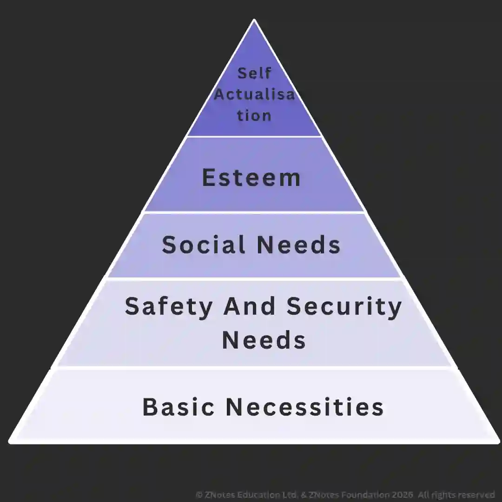

## Motivation in theory and practice

### Importance of Motivation

* A lack of proper motivation can cause reduced effort and a lack of commitment.

* However, if employees are closely watched, they may carry out good work even without motivation. This is known as negative motivation.

* In the long term, low motivation can result in high levels of absenteeism, industrial disputes, falling productivity, and profit in a business.

### Motivation Theories

**Taylor's Theory of Scientific Management**

* Created the piece rate system because he considers money as the main motivator.

* However, this theory does not take into account any individual differences, as Taylor viewed workers as mere machines that need financial reward.

**Hawthorne's Studies**

* The Hawthorne effect occurs when an individual's behavior changes, usually improves, due to knowing that they are being observed.

* Rises in output occur mainly because of stronger communication and interaction between groups, as it allows the efforts of an individual to be noticed.

**Elton Mayo**

* Workers must be motivated by ensuring that the personal satisfaction of workers is met. They must ensure that the goals of informal work groups fit in with company goals.

* One way to do this is by allowing the workers to be a part of decision-making.

**Maslow's Hierarchy of Needs**

* It is used to showcase the importance of the needs and wants of an individual. These include self-actualization (such as achieving an important goal), esteem, social requirements, safety needs (job security, health, and safety), and physiological/basic needs.

* However, some levels may not exist for some individuals, while some rewards fit into multiple categories. Companies may also have trouble telling if one level is satisfied.

**Herzberg's Two-Factor Theory**

* **Motivators**: factors that increase job satisfaction leading to an increase in productivity, e.g., recognition, nature of the job, and achievement.

* **Hygiene factors**: to prevent dissatisfaction but do not motivate by themselves, e.g., pay, conditions, policy.

* **Problems (with Herzberg's theory or application)**:

  * Workers continue to ask for better conditions

  * Job enrichment is costly

  * Can't continue in a recession

  * Benefits are only seen in the long term

  * Difference in workers' factors of satisfaction factors

### Financial Methods to Improve Staff Performance

**Piecework**

* Payments for each unit produced.

* Expands on Taylor's theory.

* Workers may take dangerous shortcuts to produce more, thus also affecting product quality.

**Commissions**

* A payment made to employees based on the number of sales they made, instead of or in addition to a basic salary

* This motivates employees and helps ensure that the business gains sales revenue

* However, employees may ignore other aspects like customer service. Alternatively, a competitive environment may be created between employees.

**Bonus**

* An additional payment over the basic wage or salary. Acts as a reward for meeting targets.

* This motivates workers to meet the targets.

* Encourages workers to stay in a company with loyalty bonuses.

**Profit Sharing**

* Profits made by a company are distributed to workers and shareholders.

* Workers are motivated to achieve goals, thus helping to unite employees and owners.

* However, individual workers do not have control over how much profit is made.

**Performance Related Pay (PRP)**

* Extra pay is given to workers for meeting targets, which could be a fixed sum or a salary.

* Targets are set by using an appraisal system that comprises employee achievements to pre-set criteria.

* However,

  * Low sums may discourage workers from meeting targets.

  * Technological failure and faulty items are not accounted for.

  * Unfairness of the interviewer while deciding the appraisal amount.

### Non-Financial Methods to Improve Staff Performance

**Delegation**

* Handing complex tasks to subordinates.

* Delegation improves the motivation of delegates if the workload is clearly explained, complete authority is provided, colleagues are aware, no interference in the task, and support & resources are provided.

**Consultation**

* Identify beneficial ideas.

* However, it is time-consuming and the views of workers could be ignored.

**Empowerment**

* Giving employees control over their responsibilities, establishing trust, decision-making control, achievement recognition, a good work environment, etc.

* Increases motivation, leading to increased productivity.

* Less stress reduces absenteeism and unnecessary meetings.

* Decisions are made by those who are equipped to make them.

* Greater employee skill and personal development.

* Make organisations more efficient and develop decisive employees.

* Less frustration for senior staff making minor decisions.

**Teamwork**

* Increases productivity by improving skills.

* Specialise and draw out hidden talents.

* Help solve difficult problems (through problem-solving).

* Ideas created.

* Develop responsibility (collective responsibility).

* Workload reduced.

* **However**:

  * Hiding differences leads to vague suggestions.

  * Waning agreements destroy team effectiveness.

  * Poor preparation.

  * Emphasis on individualisation or failure.

  * Feeling powerless.

  * Conflict in priorities.

  * Unnecessary meetings.

  * Some tasks are better done individually.

**Job Rotation**

* Involves one employee changing jobs/tasks from time to time. This could be from one department to another with similar skills or moving to a different part of the production process.

* This reduces boredom, better skills, and increases experience, which benefits the individual and the wider workplace.

* However, worker motivation is not guaranteed, and a fall in output as workers take time to settle in.

* Some workers may not like the uncertainty of job changes, which can cause dissatisfaction.

**Job Enlargement**

* Involves giving employees more work of a similar nature. This helps prevent boredom, increases employee rest/job satisfaction, and can lead to more efficient groups.

**Flexible Working**

* Helps cope with changes in demand, extends opening hours, and motivates workers.

**Job Enrichment**

* Gives employees greater responsibility by vertically extending their role in the production process.

* Helps encourage productivity and aims to reward contribution.

* However, employees who are unable to carry out extra work may be disregarded without incentives.