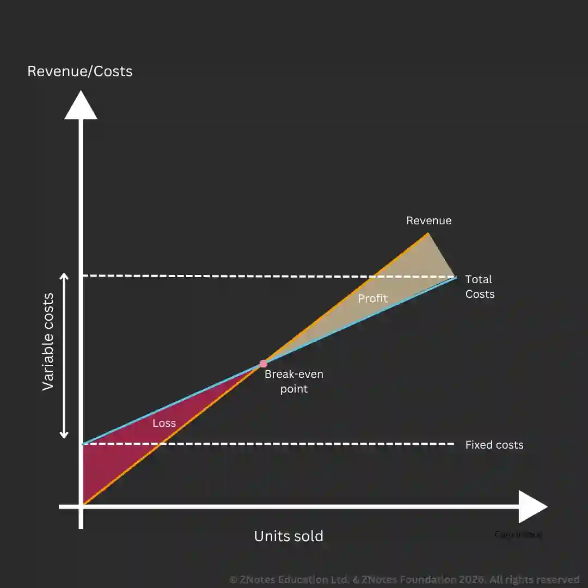

## Break-even

### **Contribution**

* Contribution is the amount of money left from sales revenue after paying all variable costs, which is then used to cover fixed costs and generate profit once fixed costs are fully covered.

* Contribution has to be calculated to help find the break-even point, make strategic decisions, and assess the profitability of a business

* **Contribution** = Sales Revenue − Variable Costs

  * **Sales revenue** =Selling Price per unit × Number of Units Sold

* **Type of Contribution**

* **Unit Contribution**

  * The contribution made by one unit sold.

  * **Unit Contribution** = Selling Price per unit − Variable Cost per unit

  * Shows how much each unit helps pay fixed costs and profit.

* **Total Contribution**

  * The overall contribution from all units sold.

  * Total Contribution = Total Revenue − Total Variable Costs (1st formula)

  * Total Contribution = Unit Contribution × Number of Units Sold (2nd formula)

  * Shows how much the business has in total to cover fixed costs and profit.

* **Example**:

  * Selling Price per unit= $15

  * Variable cost per unit= $8

  * Fixed cost: $1500

  * Unit contribution

    * Unit Contribution= 15 - 8 = $7

    * Shows that each unit sold gives $4 to pay fixed costs

  * Total contribution

    * If 1,000 units are sold,

    * Total Contribution =  10,000 – $8,000 ($8 x 1,000 units) = $2,000

    * $2000 covers the $1500 unit cost and leaves $500 as profit

### **Break-even point**

* **Break-even point:** Where total costs are equal to total revenue (no profit, no loss)

* Break-even output: the level of output needed to be produced so that total costs equal total revenue.

$$

\text{Break-even point} = \frac{\text{Fixed Costs}}{\text{Unit Contribution}}

$$

* **The graph shows:**

  * Value of total costs over a range of output

  * Value of total revenue over a range of output

  * Level of output needed to break even

  * Profit at a particular level of output

  * At what levels of outputs below the break-even output, profits and losses are made.

  * The relationship between fixed costs and variable costs as the output rises.

### **Margin of safety**

* Range of output over which a profit can be made.

  * **MOS =** Current output - Break-even output.

**Limitations of break-even analysis**

* **Output and stocks:** Many businesses hold stocks of finished goods, which makes the break-even forecast unreliable since it assumes that all output produced is sold

* **Unchanging conditions:** Break-even analysis cannot cope with sudden changes in aspects like wages, prices, technology, etc.

* **Accuracy of data:** If the underlying data is inaccurate, the conclusion drawn may also be incorrect.

* **Non-linear relationships:** This method assumes that revenue and costs have a linear relationship, which is not always the case.

* **Multi-product business:** Different products will have different variable costs and prices. It is difficult to allocate fixed costs to each product; therefore, incorrect fixed cost values lead to a less useful break-even analysis

* **Stepped fixed costs:** Some fixed costs may be increase as the business expands. Some examples could include cost of electricity or rent.