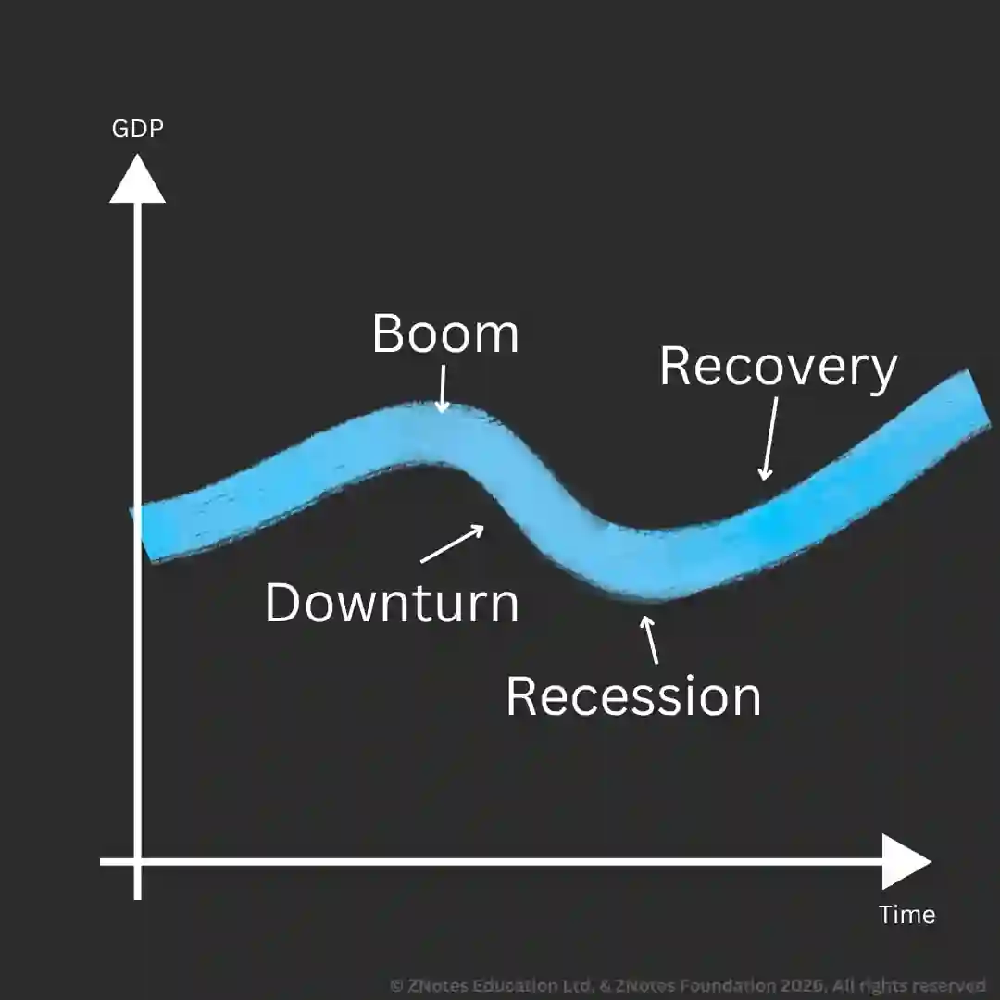

# External Influences

## Economic Influences

### **Inflation**

* A government must control inflation to keep prices stable in the economy.

* Inflation is measured using CPI which involves calculating info about prices of a basket of goods/services in the economy.

* **Effects of inflation on business:**

  * Increased costs.

  * Customers are increasing prices (those leaders cost).

  * Informing customers about price rises.

  * Management spends more time on workers and pay claim.

  * Uncertainty.

  * Borrowing lending.

  * Real value of debt decreases.

  * Interest rates may increase.

  * Reduced aggregate demand

  * Fall in International competitiveness.

  * High price, less competitiveness.

* **Business response to inflation:**

  * Search for cheaper supplies.

  * Increase prices to cover increased costs.

  * Negotiate wages, inflation proof wage demands are made.

  * Build inventories to sell at higher future prices.

  * Outsource or relocate production overseas if domestic costs are rising.

### **Exchange rates**

* The price of one currency in terms of another.

* **Appreciation:** a rise in the value of a currency.

* **Depreciation:** a fall in the value of currency

**How Exchange rates affect business:**

* Uncertainty.

* Cost money to switch from one currency to another (commission).

* Response to change in exchange rates:

* **Appreciation:**

  * Exporters: respond by lowering prices, improving quality, improving customer service, providing accountable payment terms (credit).

  * May look to increase domestic sales or foreign markets.

  * Importers: will benefit as imports will be cheaper and they may lower prices to win more market share.

  * If the appreciation is sustained, the firm may expand operations.

* **Depreciation:**

  * Trading conditions will improve for exporters hence they may raise prices to increase profit margins. Since overseas consumers will not feel the impact.

  * Alternatively, lower prices may be used to increase sales and win a larger market share.

  * If depreciation is sustained, exporters may increase operations.

  * Importers will be forced to accept low profit margins or raise price. They may adapt measures to deal with inflation if depreciation is sustained

### **Interest rates**

* Interest rates are the cost of borrowing.

* Monetary policy is the manipulation of interest rates to control the economy.

* Interest rates would be raised to reduce demand if it was rising too quickly in inflation.

**Effects of interest rates on costs:**

* Businesses have to pay higher interest payments on their loans.

* However, not all interest rates are variable (can be changed by lenders).

* Hence a rise in interest would not impact cost if a business has a fixed loan.

**Effects of interest rates on investments:**

* Cost of loans: businesses may cancel investments financed by loans due to lower profitability.

* Attractiveness of saving: firms may invest in saving schemes. Market will be higher.

* Paying off existing loans: loans with variable interest are likely to be paid off to prevent high costs.

* A fall in demand: higher interest reduces total spending in the economy.

**Effects of interest rates on demand:**

* Domestic consumption: rise in cost of loan will discourage consumers from buying consumer durable goods.

* Domestic investment: businesses cut back investments leading to a fall in demand.

* Stocks: businesses will destock in times of lower demand as less need to produces.

* Exports and imports: a rise in interest rates causes currency appreciation.

**Response to changes in interest rates:**

* **Higher interest rates:**

  * Reduces amount borrowed.

  * Postponed/cancel marginal investment plans.

  * Scale down credit, growth targets if interest rates continue increasing.

  * Loss of financial asset holding firm. Put more money in deposit accounts due to greater returns.

* **Lower interest rates:**

  * Increasing investments financed by loans due to lower cost of borrowing.

  * Demand will rise, hence firms must prepare to increase output.

  * Some firms may continue to exploit rising demand.

### **Taxation**

* **Fiscal policy:** changing taxation and government expenditure to influence the economy.

**Effects on business by change in tax:**

* **Consumer spending:** if consumers have more disposable income, there will be an increase in demand.

* **Prices:** an indirect tax will lead to an increase in prices as the seller aims to pass the tax to consumers.

* **Business costs, revenue, and profit:** higher prices decrease sales leading to a fall in revenue.

* **Business spending and investment:** increased costs reduce retained profit leading to a decrease in expenditure.

* **Export shares:** capital gains tax discourages shareholders.

* **Importing and exporting:** custom duties raise domestic prices making importing suppliers to incur increased costs.

* **Business operations and employees:** increase in tax may force a decrease in labour to reduce costs.

* **Tax avoidance and evasion:** Businesses may try to evade taxes, such as dumping in countryside to prevent landfill tax.

**Response to changes in taxation:**

* **Increase in taxes:**

  * Tax evasion.

  * Less retained profit leads to a decrease in investments.

* **Lowered taxes:**

  * Demand increases.

  * Businesses may increase production, grow, and invest more.

  * Attract more FDI

### **Government expenditure**

* Too much spending can lead to inflation and higher interest rates.

* Decreased spending will reduce demand.

* **Response to changes in government expenditure:**

  * **High expenditure:**

    * Leads to an increase in demand.

    * Could reduce development in private sector as more spending attracts investment resources in public sector.

### **Business Cycle**

**Boom:**

* Fast growing GDP.

* Firm expansion and entry.

* Rising demand, high profit.

* High income.

**Downturn:**

* Economy grown at a slower rate.

* Demand for goods will flatten/fall.

* Rising unemployment and slow down in wage increases.

* Many firms stop expanding due to profit falls and leave market.

* Price will rise more slowly.

**Recession/depression:**

* At the bottom, GDP may be flat.

* If GDP falls, the bottom of the cycle is called slump/depression.

* Demand for non-essentials falls.

* High unemployment, low business confidence.

* Prices become flat.

* Price severe version of depression is recession.

**Recovery/upswing:**

* Business and consumers regain confidence.

* Economic activity rises.

* Falling unemployment.

* Prices start to rise.

**Impact of business cycle on business:**

* **Output:** businesses selling non-essential goods will benefit during the boom due to high demand leading to an increase in output and possibly capacity. The opposite happens during a recession.

* **Profit:** business share in increase in profit during a boom. However, the profit will fall along with national income for firms to cut costs.

* **Business confidence and investment:** In the phase of boom, confidence is high which encourages businesses to take more risks. Vice versa during a recession.

* **Employment:** employment rises during a boom to cope with increase in demand. For a business, sometimes firms need to recruit the quantity and quality of staff, so fewer people seek work. The opposite happens in recession as firms lay off workers.

* **Business start-ups and closures:** more people are prepared to set up a new business in a boom, due to high demand. However, there will be fewer start-ups in recession since closures are due to cash flow problems.

**Response to the phases of the business cycle:**

* **Boom:**

  * Firms try to expand and increase profitability.

  * May invest in product development and riskier ventures like diversification.

  * May increase staff and borrowing.

  * Some sectors may try to raise prices.

* **Downturn:**

  * Slow economic growth lowers confidence and incentive to invest and expand.

  * Businesses may look to reduce costs and operations.

* **Recession/Depression:**

  * Decrease in confidence hence decreased investments.

  * If demand is falling, firms will lay off staff, downsize operations, mothball resources and start JIT/downsizing programs.

  * Many businesses will fail to survive.

* **Growth/Recovery:**

  * Customer confidence rises.

  * Demand rises leading to increased business activity, and owners are more likely to invest