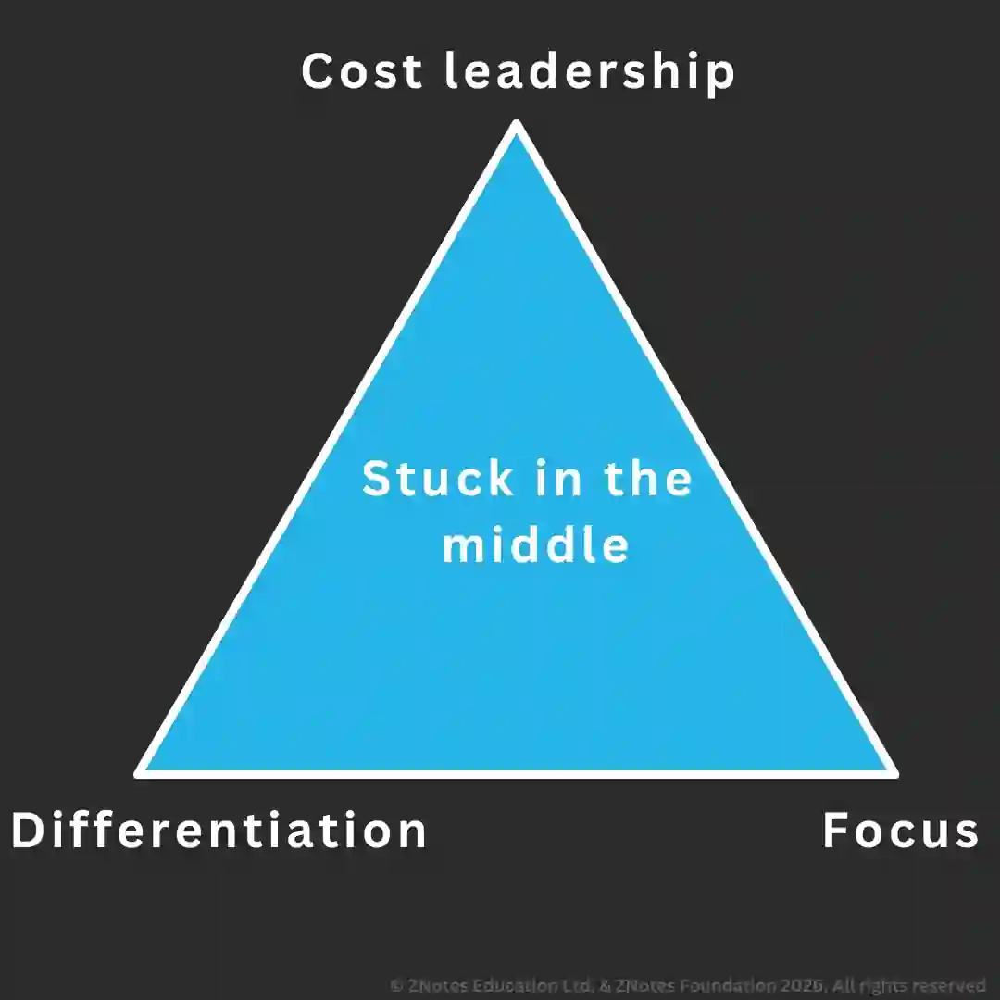

## Theories of corporate strategy

### **Porter's Strategic Matrix**

* Identifies the sources of competitive advantage that a business might achieve in a market.

* Businesses that do not adopt the strategies are failing (*stuck in the middle*).

  

* **Stuck without a clear strategy:**

  * Inefficiency (can't exploit full benefits)

  * May lose profit/market share

  * No competitive advantage

* **Cost leadership:** the lowest cost provider in the market, and may not always involve offering the lowest prices.

  * Operating at the lowest cost allows competing by increasing profits while charging market prices or increase market share while charging lower prices.

  * Often involves exploiting economies of scale and limiting options to add value.

  * May imply low quality; most firms don't compete on prices.

* **Differentiation:** involves operating with a unique position by adding value in a unique way.

  * A business could be able to charge a premium price if the USP is valued.

  * However, marketing will have to be effective in order and additional costs like R&D will be present.

  * Rivals may copy.

* **Focus:** targeting a narrow range of customers in one or two ways. This can result in:

  * Loyalty.

  * **Cost focus:** emphasising cost minimisation in a niche market.

  * **Differentiation focus:** different strategy in a niche/focused market.

### **Portfolio Analysis**

* A method of categorising all of a firm's products to decide where each one fits in strategic decisions.

* The two-step process is:

  * Give a full and detailed overview of all products in the current business portfolio.

  * Analyse the performance by examining current and projected sales, current and projected costs, competitor activity, future competition, and risks that may affect performance.

* **Boston Matrix**

  * **Stars:** high growth and strongly competitive products.

    * Require investment in hopes that they become cash cows.

  * **Cash cows:** low-growth products with high market shares.

    * They act as a funding source in other areas as they generate more cash than consumed.

  * **Question marks:** products with low market shares in high-growth markets.

    * They consume a lot of cash and return little; however, they have the potential to grow into stars.

  * **Dogs:** products with low market share and low growth markets.

    * They may break-even with little prospect of future growth.

    * They should be sold or divested.

### **Effect of Strategic and Tactical Decisions**

* **Human resources:** A strategic decision can have a long-lasting effect on the workforce, such as increasing the size of the workforce while growing.

* **Physical resources:** Some decisions, like outsourcing delivery, will force the sale of delivery vehicles.

* **Financial resources:** strategic decisions can have varying effects.

  * e.g., share capital will have a long-term effect, while an overdraft will likely be short-term.