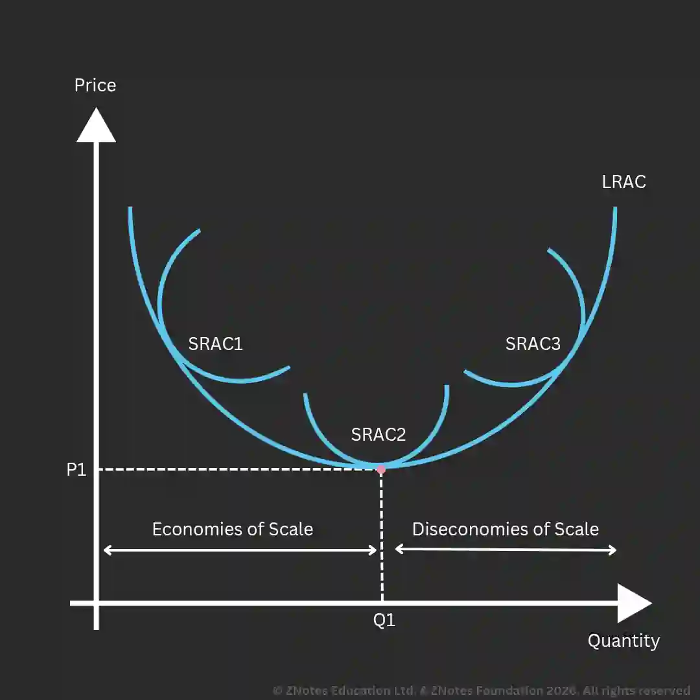

# Business Growth

## Growth

Growth is indicated when the amount of assets, use of resources, and revenue increases.

## Economies of Scale

* Economies of scale occur when average costs fall as a business grows. Over this range of output, larger businesses have a competitive advantage over smaller ones.

* The graph below shows that point A is the most efficient point to produce, as it has the lowest cost.

* After point A, the firm in question incurs diseconomies of scale as average costs increase with output.

  

**Internal Economies of Scale**

* **Purchasing** (bulk quantities might be sold with a discount by suppliers).

* **Technical** (machinery increases efficiency).

* **Specialization and managerial** (increased efficiency from specializing leads to more output per unit of time).

* **Financial** (more sources of finance for large firms, as they are seen as more reliable).

* **Risk bearing** (diversifying).

**External Economies of Scale**

* **Labor** (e.g., training by government/local institutions raises labor quality).

* **Ancillary and commercial services** (a larger industry attracts more supporting firms).

* **Cooperation** between firms in the same industry.

* **Disintegration** (specialization achieved by breaking down the production process).

### **Increased Market Power**

As a firm grows, it may be able to dominate customers and suppliers. However, authorities may investigate if this power is used for exploitation.

### **Benefits and Methods of Growth**

**Increased Market Share and Brand Recognition**

* As a business grows, its market share will grow. Brand recognition helps with this. As a brand becomes stronger, it can:

  * Charge higher prices.

  * Differentiate its product.

  * Create customer loyalty.

  * Develop a strong brand image.

  * Launch new products easily.

**Increased Profitability**

* Larger businesses are likely to make more profits. Increased profitability provides more funds for investment and innovation, which can help launch new products. A business is likely to grow if its investments are successful.

**Inorganic vs. Organic Growth**

#|
||

Organic Growth / Internal Growth

|

Inorganic Growth / External Growth

||
||

Slow

|

Fast

||
||

Less risky

|

Riskier

||
||

Pursued during initial start-up

|

Pursued once owners are confident

||
||

Long run

|

Short run

||
|#

