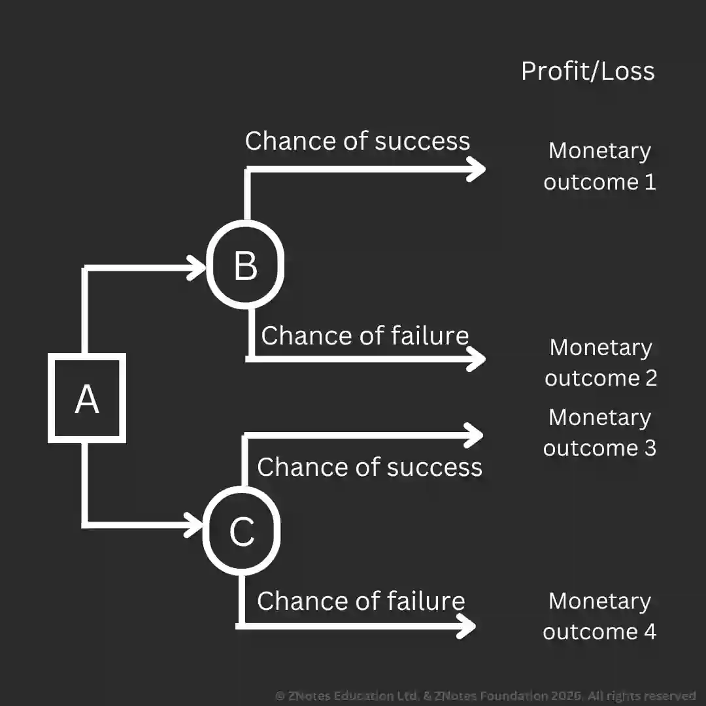

## Decision Trees

A decision tree is a method of thinking about an alternative mathematical model for managers to consider alternatives and estimate the likelihood of each.

**Features of Decision Trees**

* **Decision points**: points where decisions have to be made. The decision maker needs to choose.

* **Outcomes**: possible outcomes are represented by circles called chance nodes.

* **Probability or chance**: The chance of a particular outcome occurring. The value is between 0 to 1.

* It can be estimated using past data and research data.

* **Expected monetary value**: the financial outcome of a decision based on the preferred predicted profit or loss.

#|
||

Advantages of Decision Trees

|

Limitations of Decision Trees

||
||

Show actions not considered previously.

|

Information is not exact.

||
||

Placing numerical values on decisions improves the  result (easier to compare).

|

Decisions can be qualitative: e.g., concerned with people's opinions.

||
||

Force management to take into account all risks and separate important and unimportant tasks.

|

Time lag when making decisions.

||
||

Get a better idea of the outcome.

|

It can be time and resource-consuming unless computerized.

||
||

- 

|

Decision makers may manipulate data.

||
||

- 

|

Do not account for the dynamic nature of business.

||
|#

**Roll Back Technique** is a process of working back through a decision tree (R2R) and calculating the expected value at each node.

### **Example**

* A represents a decision node

* B and C are chance nodes

* Expected chance is the sum of the 2 or more possible outcomes for each decision (In this case, decision X and Y)

  * E.g., (Success chance \* Monetary value 1) \+ (Failure chance  \* Monetary value 2)