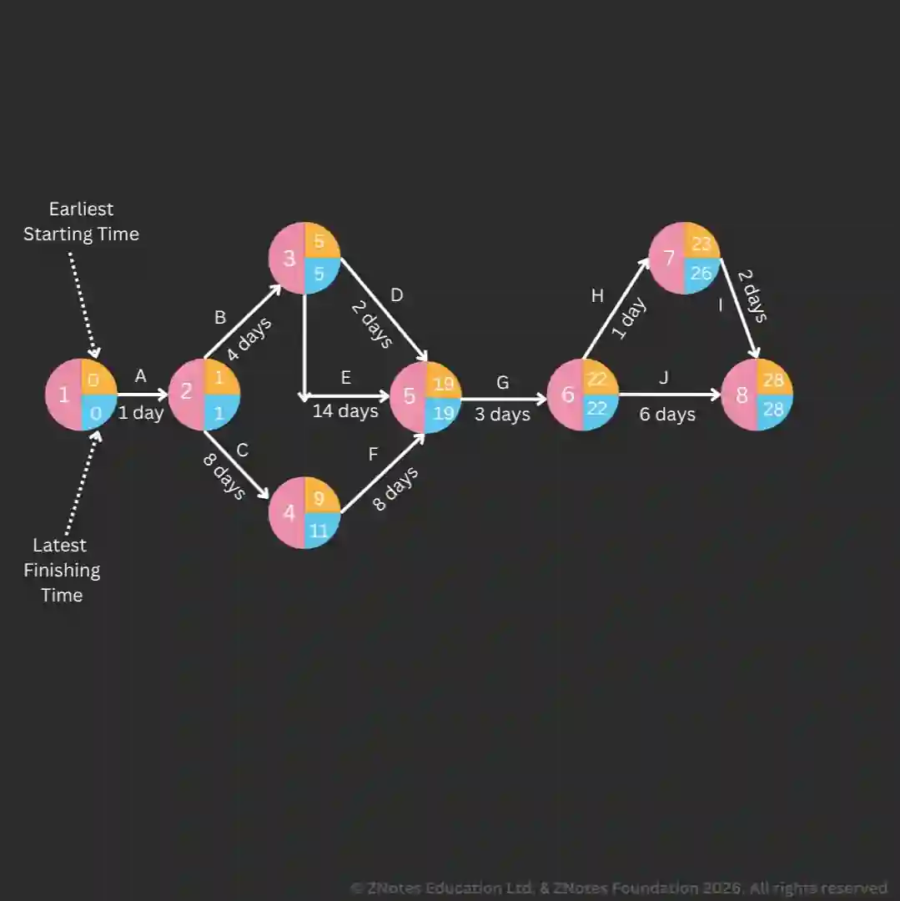

## Critical Path Analysis

### **Purpose and Uses of CPA**

* CPA is an established method used to improve the management of time and other resources.

* Makes use of network diagrams to calculate the min time to complete a project. It can also identify potential for delays.

* Used in construction, engineering, product development, software design, plant maintenance, aerospace and defence industries.

* **Efficiency:** Highlight tasks that can be done at once to help save production and installation time. Ensures deadlines are met, as the inability to meet deadlines can cause loss of customers or penalties from penalty clauses.

* **Decision making:** Decisions are made based on business models like Net Present Value.

* Length of the project is based on past info and analysis of activities.

* **Time-based management:** Techniques to minimize the length of time spent in a business process.

* **Working capital control:** Identify when resources will be needed in a working capital cycle. Network diagrams identify when materials/equipment will be used in a project (**Important in JIT**).

### **Networks and Network Analysis**

* **Networks:** Splitting operations into tasks that indicate completion once all of them have been done.

* **Network analysis:** Helps identify a sequence or "path" of tasks that are critical to the project and which, if delayed, will cause delays in the entire operation.

* Identify the tasks needed to take place, **how long is needed**, and the **order** they will be conducted in.

* **Features:**

  * **Arrows and lines show tasks** to carry out the project.

  * Some tasks can be done at once.

  * Arrows and lines cannot cross.

### **Task and Time Calculation Concepts**

* Each task is assigned a time.

* Tasks have to be completed in order.

* **Circles (nodes)** show the start and finish of a task/an operation.

* A node is present at the start and end of an operation.

* Nodes contain info about the timing involved in a project.

* **Calculating the earliest starting time (EST):** Start time of each node/task

  **Calculating the latest finishing time (LFT):** The latest time to finish each task without delay

* **Identifying the critical path:** Shows the path through the network and crosses nodes that take a large amount of time.

* **Calculating the float:**

  * Float is the amount of time a task can be delayed without causing the whole project to be delayed.

  * **Total float** is the amount of time by which a task can be delayed **without** affecting the project and is calculated by:

    * LFT of activity - EST activity - Duration of activity

  * **Free float** is the amount of time by which a task can be delayed without affecting the following task and is calculated by:

    * EST of next task - EST of current task\} - Duration

#|
||

Advantages of CPA

|

Limitations of CPA

||
||

* **Find min start time**: minimise project length.

|

* Info to estimate times may be inaccurate.

||
||

* **Improves efficiency**: improve resource allocation (redirect without affecting completion).

|

* Unexpected changes may occur.

||
||

* **Helps decision making**: quantitative technique.

|

* Some resources may be available but inflexible.

||
||

* **Helps project management:** clear order for large and complex project leading to decreased risk and efficient prioritising.

|

* Large projects may be too complex but a computer can help simplify.

||
||

* **Aid to planning**: Identifies problems in advance.

|

* Depends on skills of those who prepare.

||
|#

