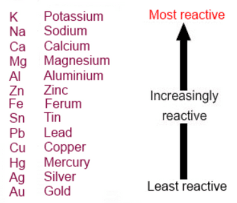

## Reactions

### **Reactions with Metals (Acid)**

* Acids react with metals to produce a salt and hydrogen gas
* a general equation would be: metal + acid → salt + hydrogen
* Example: $2HCl(aq)\ +\ Mg(s)\ \rightarrow\ MgCl_2 (aq)\ +\ H_2 (g)$

### **Reactions with Metal Oxides and Insoluble Metal Hydroxides**

* Both of these reactions will react to  form salts and water
* The reactivity of the metal does not matter in these reactions due to the reacting species being the metal ions instead of the metal atoms
* The general equation would be: metal oxide/hydroxide + acid → salt + water
* **Example:**
  * $Zn(OH)*{2(s)}$ + $2H^+$ $\rightarrow$ $Zn_{*(aq)}^{2+}$ + $2H_2O$

### **Reactions with Alkali**

* Acids react with alkalis to form salt and water
* A general equation would be: alkali + acid → salt + water
* **Example:**
  * $HCl\ +\ NaOH\ \rightarrow\ NaCl\ +\ H_2 O$
* An ionic equation for a reaction between acid and alkalis will always be: $H^{+} + OH^{-}\ \rightarrow\ H_2 O$

### **Reactions with Carbonates**

* carbonates are chemical compounds with a $CO_3^{2-}$ group
* acids will react with metal carbonates to produce salt, water and carbon dioxide
* this is shown by: metal carbonate + acid → salt + water + carbon dioxide
* Example: $MgCO_3\ +\ H_2SO_4\ \rightarrow\ MgSO_4\ +\ H_2 O\ +\ CO_2$

## Reactions with Hydrogencarbonates

* metal hydrogen carbonates will react with acids to produce carbon dioxide, water, and salt
* hydrogencarbonates are compounds with the $HCO_3^{-}$ group
* the general equation is: metal hydrogen carbonate + acid → salt + carbon dioxide + water

## Displacement reactions

* displacement reactions are when a chemical species replaces another chemical species in it’s original compound
* displacement reactions are redox reactions since the reagents undergo oxidation and reduction simultaneously
* Example:
  * $Mg\ +\ CuSO_4\ \rightarrow\ Cu\ +\ MgSO_4$
* in the above reaction, $Cu$ is displaced by $Mg$
* in terms of oxidation numbers, the oxidation number of $Cu$ changes from +2 in $CuSO_4$ and 0 in $Cu$
* the oxidation number of $Mg$ changes from 0 in $Mg$ to +2 in $MgSO_4$
* thus $Cu$ undergoes reduction while $Mg$ undergoes oxidation

## Displacement reactions in metals

* in metals, the more reactive metal will displace the less reactive metal in a solution

* the reactivity of metals is shown in the metal reactivity series

* For example, potassium can displace sodium in a solution of sodium hydroxide as it is higher in the metal reactivity scale

## Displacement reactions involving halogens

* as with metals, halogens will displace each other based on their reactivity (more reactive halogens will displace less reactive halogens)
* going down group 17 (commonly known as group 7), the reactivity of halogens decreases
* thus, fluorine can displace any halogen from its solution, whereas iodine can only displace halogens below it
* Example: $Cl_2\ +\ 2KBr\ \rightarrow\ 2KCl\ +\ Br_2$

### **Precipitation**

* **Precipitation**: a reaction where a solid is formed from reactants, not in a solid state

### **Chemical Test for Carbon Dioxide**

* Carbon dioxide could be tested through a precipitation reaction involving limewater
* The reaction occurs as follows: $CO_2 (g)\ +\ Ca(OH)_2 (aq)\ \rightarrow\ CaCO_3 (s)\ +\ H_2 O(l)$
* $CaCO_3$, which does not dissolve in water, is formed from the reaction
* Thus, the limewater turns cloudy

## Chemical test for Sulphates

* compounds containing sulphate groups can be identified using barium ions, which can be supplied using barium nitrate or barium chloride
* barium ions will displace the metal ion bonded to the sulphate group and form barium sulphate, which is insoluble, forming a precipitate
* Example: $Ba(OH)_2 (aq)\ +\ H_2SO_4 (aq)\ \rightarrow\ BaSO_4 (s)\ .2H_2 O(l)$