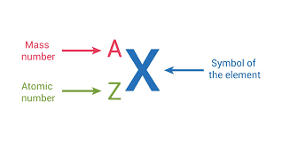
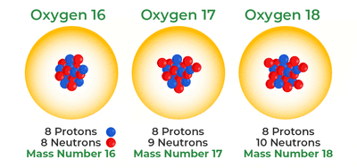

# Atomic Structure and the Periodic Table

## Atoms and Isotopes

* Atoms consist of protons, electrons and neutrons.

* Protons have a charge of +1 and relative mass of 1.

* Neutrons have a charge of 0 and relative mass of 1.

* Electrons have a charge of -1 and relative mass of 1/1840.

This is how an atom is represented:

* If X is carbon, the symbol would be ‘C’, the mass number would be 12 and the atomic number would be 6.
* The mass number is the number of protons and neutrons.
* The atomic number is the number of protons only.
* Isotopes are atoms of the same element with the same number of protons but different number of neutrons (they have the same atomic number but different mass number).
  * Isotopes of an element have the same chemical properties because they have the same electronic configuration, i.e; the number of electrons in the outer shell (which determine the chemical properties) are the same.

* Relative isotopic mass: Relative isotopic mass is defined as the mass of an isotope relative to $\frac{\text{1}}{\text{12}}$ of a carbon-12 atom

* $A_r$ = $\frac{\Sigma (\text{isotopic mass} \times \text{abundance})} {\text{Total abundance (usually 100)}}$