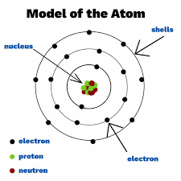
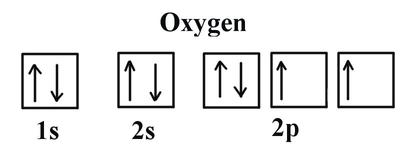
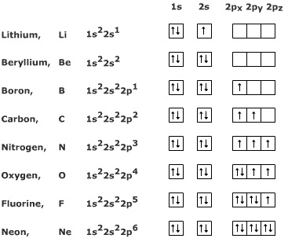

## Atomic Orbitals and Electronic Configuration

### **Overview**

* Electrons exist in shells around the nucleus of an atom.

* The first shell is titled ‘K shell’ (can hold 2 electrons).
* The second shell is titled ‘L shell’ (can hold 8 electrons).
* The third shell is titled ‘M shell’ (can hold 18 electrons).
* The fourth shell is titled ‘N shell’ (can hold 32 electrons).
* This can go up to more than 7 shells.
* The shells are further divided into sub shells called s, p, d and f and can hold 2, 6, 10 and 14 electrons respectively.
  * The K shell, for example, has a configuration of $1s^2$ subshell (2 represents the number of electrons it can hold) so the K shell holds 2 electrons.
  * The L shell will have a configuration of $2s^{2}2p^{6}$ so it can hold a total of 8 electrons.
  * Similarly, the M shell has a configuration of $3s^{2}3p^{6}3d^{10}$ and it can hold 18 electrons.
* These sub shells can be divided even further to orbitals. Namely, the p and d subshell can be divided further into 3 and 5 orbitals respectively (each orbital holding 2 electrons only).
* The s orbital has a spherical shape while the p orbital has a dumbbell-like shape.

### **Electronic Configuration**

The electronic configuration of an element is the number of electrons it holds in the order of successive shells (K, L, M…).

* The electronic configuration of magnesium (an element with 12 electrons) is 2, 8, 2.

* 2 electrons in the K shell, 8 in the M shell and 2 in the L shell.

* When dealing with the subshells and orbitals, however, the configuration becomes:

  $1s^{2}2s^{2}2p^{6}3s^{2}$

The electronic configuration of an element can also be represented using box notation:

* The box notation configuration for oxygen is:

* An arrow represents one electron.
* Only two electrons can exist in one orbital (box).
* According to Hund’s Rule, electrons occupy the orbitals singly before pairing takes place. This means that two electrons **cannot** exist in one orbital when there are other empty orbitals in **different** subshells.
* According to the Pauli Exclusion Principle, two electrons can only exist in one orbital if they have opposite spins (hence the up and down arrows).
* For an element with more than 18 electrons, like calcium, the electronic configuration is $1s^{2}2s^{2}2p^{6}3s^{2}3p^{6}4s^{2}$ rather than $1s^{2}2s^{2}2p^{6}3s^{2}3p^{6}3d^{2}$.
  * This is because the 3d subshell is at a higher energy level than the 4s subshell, thus the electrons tend to occupy 4s before 3d.
* Chromium (24) and copper (29) are two anomalies when it comes to their electronic configurations
  * Chromium: $1s^{2}2s^{2}2p^{6}3s^{2}3p^{6}4s^{1}3d^{5}$
  * **Note** how rather than $4s^2$ it is given as $4s^1$, this is because the 3d orbital takes an electron from the 4s orbital to complete its shell (the d subshell has 5 orbitals).
  * Copper: $1s^{2}2s^{2}2p^{6}3s^{2}3p^{6}4s^{1}3d^{10}$
  * Similarly, the 3d subshell of copper takes an electron from 4s to obtain a complete shell.
  * $3d^{4}$ and $3d^{9}$ **do not** exist in electron configurations of elements, only ions.
* Electronic configuration can also be written by using symbols for noble gases:
  * Neon has 10 electrons ($1s^{2}2s^{2}2p^{6}$)and so can be used for configurations for elements with more than 10 electrons.
  * Example, magnesium (12): [Ne] $3s^{2}$ and manganese (25): [Ar] $4s^{2}3d^{5}$ because argon has 18 electrons.
* The following depicts the electronic configuration of some common elements:

