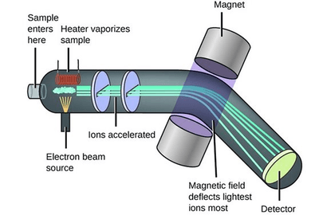
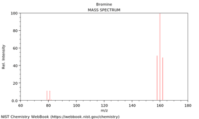

## Mass Spectrometry

* A mass spectrometer is an instrument that measures the mass-to-charge ratio of ions.

* It can be used for various applications, including carbon dating, checking for drug use in sports, etc.

* There are four stages a **vaporised** sample undergoes in a mass spectrometer:

  * Ionisation: the sample is bombarded by high energy electrons, which removes an electron and form an ion (only ions can be affected by the magnetic and electric fields in the following stages).
  * Acceleration: an electric field speeds up the ions, so they’ll have the same kinetic energy and will travel in the same direction.
  * Deflection: an electromagnetic field changes the course of the ions, and the magnitude of deflection depends on the mass of the ions (lower masses deflect more and greater masses deflect the least).
  * Detection: the ions that have just the right mass-to-charge ratio reach the screen and are detected, producing a mass spectrum.

* A mass spectrum of an element provides information about the isotopes and their relative abundances.

* From the details provided in the mass spectrum, it is possible to calculate the relative molecular mass of that element:

* The above mass spectrum belongs to bromine, which has two isotopes: Br-81 and Br-79.
* The peaks at the right are molecular masses of 160 (79+81), 158 (79+79) and 162 (81+81).
* The ratio of Br-79 to Br-81 is 1:1, which explains why the molecular masses have a ratio of 1:2:1 (approximately).