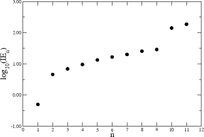

## Ionisation Energies

* The first ionisation energy is the energy needed to remove one electron from each atom in one mole of gaseous atoms to form 1 mole of gaseous 1+ ions (measured in kJ mol$^{-}$).

  * The first ionisation energy of an element, M, is:

    M$(g)$ → M$^+(g)$ + e$^{-}$

  * Second ionisation energy:

    M$^+(g)$ → M$^{2+}(g)$ + e$^{-}$

* The outer electrons are removed before the inner ones as the electrons are harder to remove the closer they are to the nucleus.

* The successive ionisation energies of an element increase because the electrons removed progressively get closer to the nucleus.

* The graph shows the successive ionisation energies of sodium.
* The log value of I.E. is used because the actual values are too large to plot.
* The innermost two electrons are the hardest to remove, and the outermost electron is the easiest.
* The graph shows that sodium has three shells; this is represented by a “big jump” after the first electron and after the ninth electron.
* The electronic configuration of sodium is thus 2, 8, 1