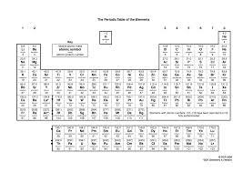
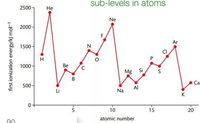

## The Periodic Table

* The vertical columns are called groups.
* The horizontal rows are called periods.
* The periodic table also has blocks:
  * The s-block consists of elements in groups 1 and 2
    * The outer electrons in an s-block element are in an s-orbital.
  * The p-block consists of elements in groups 3 to 8
    * The outer electrons in a p-block element are in a p-orbital.
  * the d-block consists of elements Sc to Zn in period 4 and Y to Cd in period 5.

### **Periodic Properties**

There are certain recurring patterns or trends in the periodic table.

* The atomic radii of the elements increase down the group and decrease across the period.

  * The atomic radii is the distance from the center of the nucleus to the outer electron of an atom.
  * The trend is explained by the increasing number of protons across the period, which increases the effective nuclear charge (the force of attraction between the nucleus and the electrons).
  * Thus, the outer electrons are “pulled” closer to the nucleus, reducing the atomic radii in the process (additionally, the number of shells remains the same).
  * As the number of protons increases, the atomic radius increases because the number of shells increases, shielding effect (repulsion of outer electrons away from the core electrons) increases, meaning the outer electron is further away from the nucleus.

* The first ionisation energies increase across the period and decrease down the group.

* As the effective nuclear charge increases, the ionisation energy increases (across the period) because it is harder to remove an electron.
* Down the group, the number of shells increases, which increases the shielding effect and decreases the attraction between the nucleus and the outer electrons, thus making it easier to remove an electron so the ionisation energy decreases.