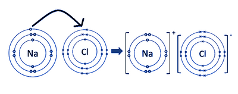
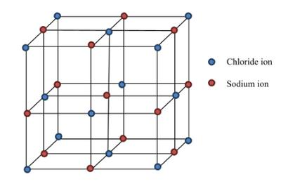
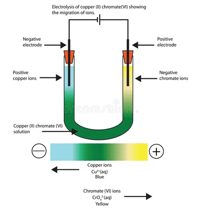
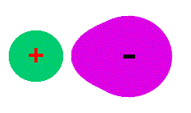
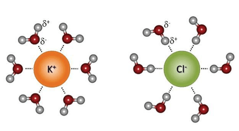

# Bonding and Structure

## Ionic Bonds

* Ionic bonding is the strong electrostatic force of attraction between positive and negative ions.

* Ionic bonds typically occur between metals and non-metals.

* All elements try to achieve a full outer shell of eight electrons **(octet rule)**.

* Metals usually lose electrons and are thus called positive ions or cations while non metals usually gain electrons and are thus called negative ions or anions.

* Dot and cross diagrams are used to represent the formation of ionic bonds.

* The ionic bond between sodium chloride:

* By losing one electron from its outer shell, sodium remains with eight electrons in the outer shell.
* Similarly, by gaining one electron, chlorine has also achieved the octet rule.

**The structure of NaCl:**

* There are certain factors that affect the strength of the ionic bond:
  * The strength of the bond is inversely proportional to the ionic radii (size of the ion).
  * The strength of the bond is directly proportional to the charge of the ions.
* Anions are always bigger than its parent atom while cations are always smaller than its parent atom.
  * Example: $Cl^-$ is larger than $Cl$ and $Na^+$ is smaller than $Na$.
  * This is because of the attraction between the nucleus and electrons.
* Ionic structures form giant ionic lattice in the solid state.

**Evidence for the Existence of Ions**

* Migration of ions observed during the electrolysis of ionic compounds is a convincing evidence for the existence of ions.

* The compound being decomposed by the passing of electricity is called the electrolyte.

* When direct current is passed through a green solution of copper (II) chromate (IV) solution in a U-tube, blue copper ions (positive) migrate to the negative electrode and yellow chromate ions (negative) migrate to the positive electrode.

* The negative electrode is the cathode and the positive electrode is the anode.

**Ionic Radii and Polarisation**

* Down the group, the ionic radii increases due to the increasing number of shells.
* Across the period, the ionic radii (for both cations and anions) decrease due to the increased number of protons.
* Isoelectronic ions are those with the same number of electrons and electronic configuration ($Mg^{2+}$ and $F^-$).
* Polarisation is the distortion of the electron density of a negative ion (anion).
* Polarising power is the ability of a positive ion (cation) to distort the electron density of its neighbouring negative ion (anion).
* Cations (small in size) are stronger than anions in an ionic bond, so electrons are attracted more toward the cations, distorting the electron cloud of anions in the process.
  * Note that anions **do not** give up their electrons, but rather only lean toward cations.

* Cations have the polarising power and anions are polarised.
* Factors affecting polarisation:
  * For cation: (i) small size (ii) large charge
    * For example, $Mg^{2+}$ is more polarising than $Na^{+}$
  * For anion: (i) large size (ii) large charge
    * For example, $O^{2-}$ is polarised more than $S^{-}$

**Physical Properties of Ionic Compounds**

* They have high melting and boiling points.
  * A large amount of energy is required to overcome the strong electrostatic force of attraction between the ions.
* They cannot conduct electricity in the solid state.
  * They only conduct electricity in molten or aqueous states when the lattice breaks and ions are free to move and carry charge.
  * There are no free ions to carry charge in the solid state.
* Many are soluble in water.
  * The energy to break apart the lattice is supplied by hydration.

  * The diagram depicts the hydration of KCl by water molecules:

