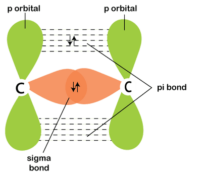
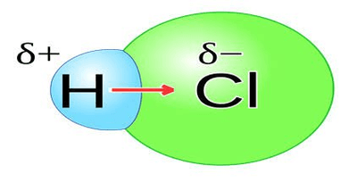
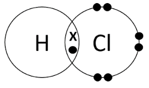
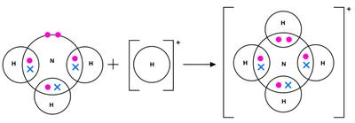
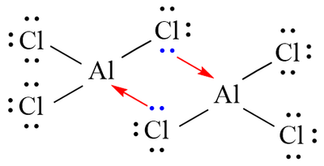
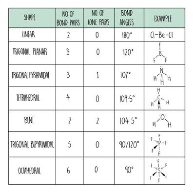

## Covalent Bonding

* Covalent bond is the electrostatic force of attraction between two nuclei and the shared pair of electrons.
* Covalent bonds arise from the overlap of atomic orbitals.
* An end-on-end overlap forms a sigma (σ) bond and a sideways overlap forms a pi (𝛑) bond.
  * Sigma bonds are symmetrical and in line with the nucleus, it forms single bonds.

  * Pi bonds are non-symmetrical and not in line with the nucleus, it is responsible for double and triple bonds.

  * A pi bond is weaker than a sigma bond because pi bonds have poor orbital overlap.

  * A pi bond **always** follows a sigma bond.

* The distance between the nuclei of two covalently bonded atoms is called the bond length.
* The strength of a covalent bond is affected inversely by the bond length.
  * A triple bond, despite being shorter than a double or single bond, is generally stronger than both.

### Electronegativity and Bond Polarity

* Electronegativity is the tendency of an atom to attract shared pair of electrons toward itself in a covalent bond.
  * Across the period, the electronegativity increases because the effective nuclear charge increases, the size of atoms decreases and the shielding effect remains the same.
  * Down the group, the electronegativity decreases because the effective nuclear charge decreases, the size of atoms increases and the shielding effect increases.
* The distribution of electrons in the electron density map of similar atoms (like $Cl_2$) will show no distortion and is evenly distributed.
* Conversely, when there is a difference in electronegativity, the electron density map is unevenly distributed in favour of the most electronegative atom in the bond (like in $HCl$ where Cl is more electronegative than H).
  * Such bonds are called polar covalent bonds, where the more electronegative atom has a **partial** negative charge:

* The Paling scale (0-4) is the numerical scale used to measure electronegativities.
* 0 is the least electronegative and 4 is the most electronegative.
* Halogens are the most electronegative group in the periodic table and fluorine is the most electronegative element.
* When the difference in electronegativity between two atoms in the covalent bond is more than 1.9 (approx.), the bond becomes ionic.

### Dot and Cross Diagrams

* Covalent bonds can be represented using dot and cross diagrams (lewis structures):

* This is the dot and cross diagram for HCl, representing a full outer shell for chlorine (octet rule).
* Octet rule should be met in order to obtain stability.
* There are some compounds exempted from the octet rule, however.
  * Elements like Si, P, S, Cl can have more than eight electrons (they are in the third row, so they can have up to 18 electrons).
  * Elements like C, N, O and F can have an incomplete shell but not more than eight electrons.

### Dative Covalent Bond

* A dative bond is formed when two atoms share a pair of electrons, both electrons being donated by one atom.

* The diagram shows a dative covalent bond formed in ammonium.

* $Al_{2}Cl_{6}$ is another example of a dative bond.

* Here, the empty orbital of Al overlaps with the orbital of Cl containing a lone pair.

### Shapes of Molecules and Ions

* The electron-pair repulsion theory states that:

  * The shape of a molecule or ion is caused by repulsion between pairs of electrons, that surround the central atom.
  * The electron pairs tend to occupy areas around the central atom so that the repulsion between them is at a minimum.
  * lone pair-lone pair repulsion is greater than bond pair-bond pair repulsion.

* The table shows the shape and bond angles for molecules and ions:

* The presence of a lone pair (electron pair not involved in bonding) reduces the bond angle by about 2.5$^\circ$.

### Polarity of Molecule

* When a separation of charges occur in a covalent molecule due to the difference in electronegativity, it is referred to as a dipole.
* If a molecule is symmetrical, the dipoles cancel out and the molecule is non-polar **despite** having polar bonds.
* The table below gives information about bond polarity:

|Shape|Polarity|Explanation|
|:---|:---|:---|
|Linear|Non-polar|Dipoles cancel out|
|Trignonal Planar|Non-polar|Dipoles cancel out|
|Tetrahedral|May or may not be polar|Dipoles may cancel out (like in $CCl_4$) or may reinforce one another (like in $CHCl_3$)|
|Trigonal Pyramidal|Polar|Dipoles reinforce one another|
|V-shaped|Polar|Dipoles reinforce one another|
