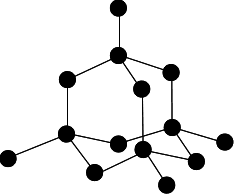
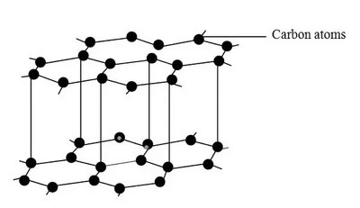
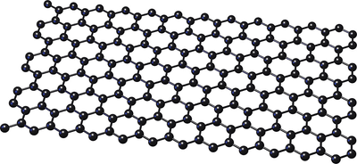

## Giant Covalent Lattices

* Giant Covalent Lattices consist of several atoms bonded to each other covalently.
* The stricture and information of some giant covalent lattices:

**Diamond**

* Each carbon atom is bonded to 4 other carbon atoms (sigma bonds only)

* Giant, 3-D, rigid, tetrahedral arrangement, with bond angle= 109.5$^\circ$

* Extremely hard due to strong C-C bonds

* High melting point due to great number of C-C bonds

**Graphite:**

* Layered structure

* Each carbon atom is bonded to 3 other carbon atoms (sigma bonds only)

* Interlocking hexagonal rings

* Layers can easily slide over each other when gas molecules are absorbed on the surface (used as a lubricant)

* Fair conductor of electricity

* High melting temperature

* Weak forces despite the giant covalent structure

* Bond angle=120$^\circ$

**Graphene:**

* Very thin sheet; one atom thick (used in electrical devices)

* Similar properties of graphite

* Single hexagonal layer

* Each carbon atom is bonded to 3 others

* It has delocalised electrons

* Bond angle=120$^\circ$