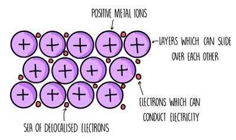

## Metallic Bonding

* Metallic bonding refers to strong electrostatic force of attraction between positive ions and delocalised electrons.

### **Metallic compounds have:**

* **High melting temperature**
  * A lot of energy is needed to overcome the strong electrostatic force of attraction.
  * When there are more delocalised electrons per atom, the melting temperature increases.
* **Good electrical conductivity**
  * Delocalised electrons can carry a charge when a potential difference is applied.
* **Good thermal conductivity**
  * They can conduct heat.
* **Malleability**
  * Can be hammered into thin sheets.
  * Layers are able to slide over each other while still being held by delocalised electrons.
* **Ductility**
  * They can be drawn into wires.