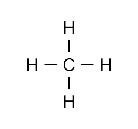
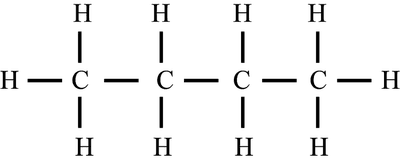
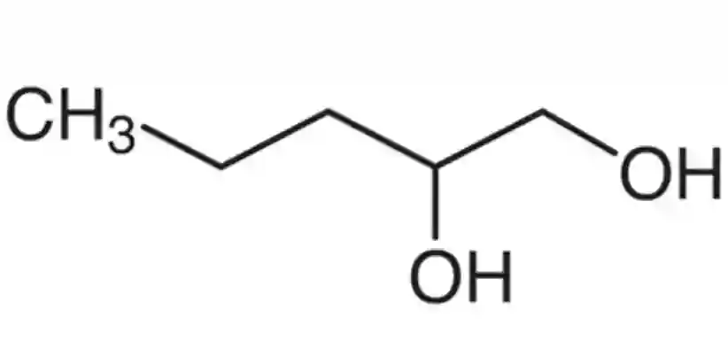
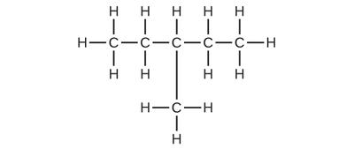

# Alkanes

## Introduction to Organic Chemistry

* The only condition for a compound to be an organic  compound is that is contains a carbon atom.
* Hydrocarbons are a set of organic compounds with carbons and hydrogens only.
* Alkanes are organic compounds with the general formula $C_{n}H_{2n+2}$ (n is the number of carbon atoms).
* Alkanes are **saturated** **hydrocarbons**, meaning they do not have a carbon-carbon double bond and **only** contain carbons and hydrogens.
* The lack of carbon-carbon double bonds indicate that all alkanes contain sigma (σ) bonds only.
* Methane, $CH_{4}$, is the simplest alkane.
  * Here, one carbon atom is bonded to four hydrogen atoms (remember: carbon can make four bonds).

### Nomenclature and Representation

* The names of organic compounds reveal a lot.
* The number of carbon atoms, the number and position of branches (if there are any), the functional groups present, etc. are information one can get from the names assigned to the organic compound.
* According to the number of carbon atoms, the compound can have different root words.

|No. of carbon atoms|Word root|
|:---|:---|
|1|Meth-|
|2|Eth-|
|3|Prop-|
|4|But-|
|5|Pent-|
|6|Hex-|
|7|Hept-|
|8|Oct-|
|9|Non-|
|10|Dec-|

* The rules for naming are assigned by the IUPAC (International Union of Pure and Applied Chemistry) and they are as follows:
  * Locate the longest chain (parent chain).
  * Count the number of carbon atoms in this chain and assign the appropriate root word.
  * When locating the branch, make sure you start counting from the carbon that is **closest** to the branch.
  * Prioritize the functional group (if) present.
  * The name of the compound must begin with the branch present.
  * Prefixes such as di, tri and tetra are used in the case of multiple similar branches or functional groups.
  * In the case where two branches are located in the same position, the branches are named in alphabetical order.

### Functional Groups

* Functional groups are atoms or groups of atoms that determine the properties of the compound they are attached to.
* Homologous series is a group of organic compounds with the same general formula, functional groups and chemical and physical properties.
* The suffix of the name of an organic compound depends on the functional group present:

|Functional Group|Suffix|
|:---|:---|
|Alkane|-ane|
|Alkene|-ene|
|Alcohol|-ol|
|Aldehyde|-al|
|Carboxylic Acid|-oic acid|
|Ketone|-one|

### Methods of Representation

**Displayed formulae:**

* This is the displayed formula of butane.
* Every bond is shown in solid lines.

**Skeletal Formulae:**

* This is the skeletal formula of 1,2-propandiol.
* Every intersect represents a carbon atom.
* The bonds between carbons and hydrogens are not shown.

**Structural Formulae:**

* The structural formula for this displayed structure is $CH_{3}​CH_{2}CH(CH_{3}​)CH_{2}​CH_{3}$​
* The branches (in this case; the methyl group) is written inside brackets.

**Molecular Formulae:**

* $C_{4}H_{10}, C_{6}H_{12}, C_{5}H_{10}$ etc.
* No information about branches will be give by the molecular formula.

**Empirical Formulae:**

* The empirical formulae for the above molecular formulae are $C_{2}H_{5}, C_{3}H_{6} , CH_{2}$
* Empirical formula is the simplest whole number ratio of the compound.