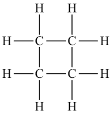
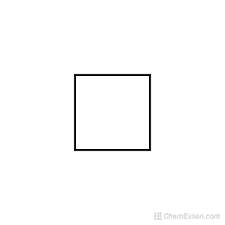
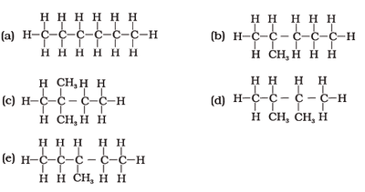

## Cyclic Structures and Isomers

### Cycloalkanes

* Alkanes can be arranged in ring-like structures.
* These are called cycloalkanes.

**Cyclobutane:**

* (i) displayed structure

* (ii) skeletal structure

* The general formula for cycloalkanes $C_{n}H_{2n}$ like that of alkenes. Despite the same general formula, cycloalkanes **do not** behave like alkenes do.

### Isomers

* Isomers are compounds with the same molecular formula but with different arrangements of atoms or groups.

* Alkanes exhibit structural isomerism.

* Isomers of hexane:

* Structural isomers have the same molecular formula but different structural arrangement.

* **Example**: butane and methylpropane

* Structural isomerism can be of two types: (i) Chain Isomerism (ii) Position Isomerism

  * Chain isomers have different chain lengths like that seen in butane and methylpropane.
  * Position isomers differ in the position of double bonds, functional groups or branches like 2-ethylpentane and 3-ethylpentane.