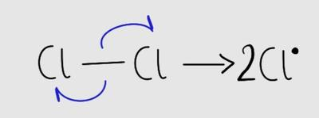

## Free Radical Substitution Reaction

### Bond Fission

* Bond breaking is called bond fission.
* They can be of two types:

**(i) homolytic fission**

* Homolytic fission is **even** bond breaking.
  * $Cl_{2}$ → $Cl^{\bullet}$ + $Cl^{\bullet}$
  * The electrons shared in the covalent bond are split evenly between both chlorine atoms, thus forming free radicals.
  * Free radicals are species with an unpaired electron and is represented with a dot ($Cl^{\bullet}$).

**(ii) heterolytic fission**

* Heterolytic fission is **uneven** bond breaking.
  * $HCl \rightarrow H^{+} + Cl^{-}$
  * The electrons shared between the two atoms in the covalent bond are split unevenly, with the chlorine receiving both of them (since it is more electronegative), thus forming ions.

### Mechanism for Free Radical Substitution Reaction

* Alkanes react with halogens or hydrogen halides in the presence of **sunlight (UV light).**
* $CH_{4} + Cl_{2} \rightarrow CH_{3}Cl + HCl$
* There are three steps to this reaction:

**Initiation**

* The arrow used here is called a half-curly arrow and it represents the movement of one electron.
* Sunlight is used in the initiation step of the reaction to provide energy for the homolytic bond fission of chlorine.
* Only little sunlight is necessary because the chlorine radical can be recycled.

**Propagation**

* $CH_{4} + Cl^{\bullet} \rightarrow CH_{3}^{\cdot} + HCl$

  $CH_{3}^{\bullet} + Cl_{2} \rightarrow CH_{3}Cl + Cl^{\bullet}$

* $CH_{3}Cl + Cl^{\bullet} → CH_2Cl^{\bullet} + HCl$

  $CH_{2}Cl^{\bullet} + Cl_{2} \rightarrow CH_{2}Cl_{2} + Cl^{\bullet}$

* Propagation can continue until all the hydrogen is replaced by chlorine.

**Termination**

* $Cl^{\bullet} + CH_{2}Cl^{\bullet} \rightarrow CH_{2}Cl_{2}$
* Termination marks the end of the reaction.
* Two free radicals react and form a stable species, thus terminating the reaction.
* $H^{\bullet}$ is never formed.