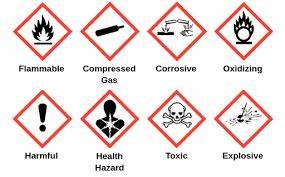

## Hazards, Risks and Risk Assessment

* Hazards are fixed, but risk can vary.

* Hazards refers to the innate properties of a chemical.

* Risk refers to how the chemicals are used.

* Risk assessment refers to identifying, and analysing potential risks to minimise them.

* Hazard symbols and their meanings:

