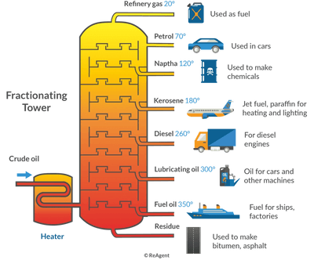

## Fuels

* A fuel is a source of energy.
* Crude oil is a mixture of hydrocarbons and have very little use if unprocessed.
* Crude oil undergoes fractional distillation, cracking and eventually reforming to produce alkanes which are in demand.
* Fuels are typically produced from crude oils through fractional distillation. But, this method is non-renewable and toxic.
  * In fractional distillation, the compounds evaporate and condense. The separation of the compounds into fractions depend on the difference in boiling temperatures.

* After fractional distillation, long hydrocarbon chains (less demand) undergo cracking to produce shorter chains.
* The catalyst used for cracking is usually zeolite (Al, Si and O).
* Possible Reactions:
  * Alkane $\rightarrow$ Alkene + Alkane
  * Alkane $\rightarrow$ 2Alkene + Hydrogen
  * If an alkane is one of the products, hydrogen cannot be another possible product.
  * Example: $C_{8}H_{18} \rightarrow C_{4}H_{8} + C_{4}H_{10}$
* Reforming follows cracking and it involves the conversion of long, unbranched hydrocarbons to branched/cyclic hydrocarbons (the latter gives more energy).
  * The catalyst used usually is platinum.
  * Example: $C_4H_{10} \rightarrow C_4H_8$ + $H_2$

### Combustion of Alkanes

* Alkanes undergo **complete combustion** in the presence of excess oxygen to produce water and carbon dioxide.
  * $C_{5}H_{12} + 8O_{2} \rightarrow  5CO_{2} + 6H_{2}O$
  * It helps to start by balancing the carbon, followed by the hydrogen and eventually oxygen.
* In the presence of limited oxygen, alkanes undergo **incomplete combustion**, producing water and carbon monoxide.
  * $C_{5}H_{12} + 5.5O_{2} \rightarrow 5CO + 6H_{2}O$
  * Carbon monoxide is a harmful gas that binds with the haemoglobin in the blood instead of oxygen, thus causing death.

**Acid Rain**

* Acid rain (rain with acidic pH) can be caused by both oxides of sulfur and that of nitrogen.

**Sulfur:**

* $S + O_{2} \rightarrow SO_{2}$

  $2SO_{2} + O_{2} \rightarrow 2SO_{3}$

  $SO_{3} + H_{2}O \rightarrow H_{2}SO_{4} \text{AND} SO_{2} + H_{2}O \rightarrow H_{2}SO_{3}$

* $N + O_{2} \rightarrow 2NO$

  $2NO + O_{2} \rightarrow 2NO_{2}$

  $2NO_{2} + H_{2}O \rightarrow HNO_{2} + HNO_{3}$

* Being one of the major sources of air pollution, exhaust systems of cars have catalytic converters that improve the air quality in the presence of catalysts like rhodium, platinum or palladium.

* Carbon monoxide and other unburnt hydrocarbons (harmful) react with nitrogen oxides to form carbon dioxide and water (less harmful).

### Alternative Fuels

* There are increasing attempts to produce fuels from:
  * renewable sources (sources that do not necessarily run out).

  * carbon-neutral sources that gives out the carbon dioxide during combustion that it absorbed in its lifetime so that the total amount of carbon dioxide in the atmosphere has no change.

    * Trees are carbon neutral

  * Bioalcohols (like bioethanol) , despite being produced from plants, are not carbon-neutral as the processing of these plants to the factory level involves the use of energy and release of carbon dioxide.

## Comparing Fuels

|Biofuels|Fossil Fuels|
|:---|:---|
|Renewable|Non-renewable|
|Closer to being carbon neutral|Far from being carbon neutral|
|Much land is required for growing (prompts ethical concerns)|Comes from underground sources, so no land is needed|
|Low yield|Significantly high yield|
|Costs in growing, processing and transport|Costs in exploration and drilling|
