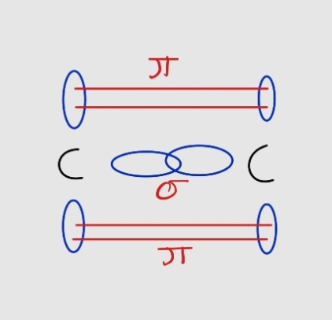

# Alkenes

* Alkenes are simply hydrocarbons with one or more carbon-carbon double bond. **Examples**: ethene, but-1-ene, pentene, and so on.
* They have a general formula of $C_{n}H_{2n}$
* The C=C bond in an alkene molecule consists of both a sigma ($\sigma$) and a pi ($\pi$) bond (a pi bond always follows a sigma bond).
  * A sigma bond indicates an end-to-end overlap.
  * A pi bond indicates a sideways overlap and is typically weaker than a sigma bond.

* The presence of the relatively weaker pi bond in an alkene makes it much more reactive than an alkane.