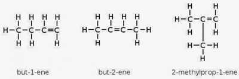
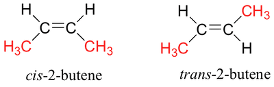
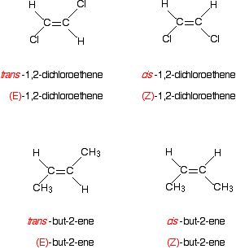

## Geometric Isomerism

* Isomers are compounds with the same molecular formula but with different arrangements of atoms or groups.

* Alkenes exhibit both structural and stereoisomerism.

* Stereoisomers share the same structure but differ in the spatial or three-dimensional arrangements of their atoms.

**Isomers of butene:**

* Geometric Isomerism is one of the two types of stereoisomerism.

* It arises when compounds differ due to differently arranged atoms or groups across a C=C bond.

* This type of isomerism is possible in alkenes because of the restricted rotation about the C=C bond, meaning there can be no rotation around the double bond.

* For geometric isomerism to occur in alkenes,  non-identical groups must be attached to each carbon atom in the C=C bond.

  * For example, you cannot say chloroethene exhibits geometric isomerism because of its identical hydrogen atoms.

* Geometric isomers can be named using the prefixes **-cis** and **-trans**.

  * -cis is used when the identical atoms/groups are on the same side

  * -trans is used when the identical atoms/groups are on different sides.

* The cis-trans naming system can only be used in the presence of one set of non-identical groups attached to each carbon in the C=C bond.

* In cases of two or more non-identical atoms/groups, the E-Z naming system is used.

* The E-Z naming system is more comprehensive than cis-trans system and here’s how it works:

  * Using the Priority Rule, the priority of the different groups/atoms should be determined.

    * Priority is determined by the atomic number. **Example:** H has a priority of 1, $CH_{3}$ has a priority of (12+1x3) 15. Here, $CH_{3}$ has a higher priority than H.

  * Determine the atom or group with the higher priority on each of the two carbons.

  * Finally, check if the higher priority groups are on the same side (Z isomer) or on opposite sides (E isomer) of the carbon.

