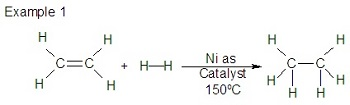
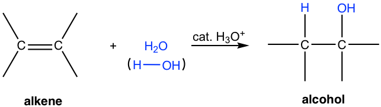
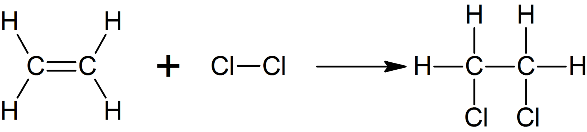
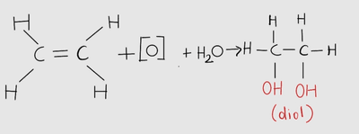

## Addition Reaction

* Addition reactions in alkenes typically involve the breaking of the pi (𝛑) bond and replacing it with another atom.
  * $C_{2}H_{4} + Br_{2} \rightarrow C_{2}H_{4}Br_{2}$
    * Brown bromine water, when added to an alkene, undergoes an addition reaction, causing the solution to become colourless (decolourised). This is used as a common test for alkenes.

### **Addition Reactions of an alkene:**

**Hydrogenation:**

* **Reactant:** Hydrogen

* **Catalyst:** Nickel

**Hydration:**

* **Reactant:** Water

* **Catalyst:** H+ (phosphoric acid/Sulphuric acid)

**Halogenation:**

* **Reactant**: Any halogen

* **Catalyst:** (NA)

### Oxidation of alkenes:

* This example is one of both addition and oxidation, producing a diol (two hydroxyl/-OH groups).
* Similar to how H+ represents an acid, [O] represents an oxidising agent.
* The oxidising agent (like potassium permanganate) produces an oxygen atom and the water in the solution contributes another oxygen atom and two hydrogen atoms.
* In the reaction with $KMNO_{4}$, purple potassium permanganate turns colourless and so, can be used as a chemical test for alkenes (similar to bromine water).