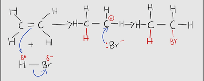
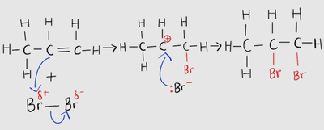
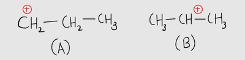

## Mechanism of Addition Reaction

* Alkenes undergo electrophilic addition reactions. This reaction involves addition and an attack by an electrophile.

  * An electrophile accepts or seeks an electron pair from another atom or molecule during a chemical reaction.
  * Example: $C_{2}H_{4} + HBr \rightarrow C_{2}H_{5}Br$
    * Here, HBr serves as an electrophile

* Complete reaction of an alkene with a hydrogen halide:

* $H\ ^{-}Br$ is a dipole (separation of charges), with H being partial positive and Br being partial negative.

* Hydrogen halides and halogens react in this same way.

* When dealing with alkenes other than ethene, which is a symmetrical molecule, it is important to consider the Markovnikov’s Rule.

* According to this rule, generally, the partial negative part of the electrophile will attach itself to the carbon with the fewer number of hydrogens.

  * This forms what is called the “major product”

  * The remaining products are called “minor products”

  * **Example:**

* Despite being the same atoms, $Br \ ^{-}Br$ is a dipole because of the induced dipole forces.
* In the above example, both the minor and major products would be the same.
* On the other hand, if the electrophile was $H\ ^{-}Br$, the major product would be 2-bromopropane and the minor product would be 1-bromopropane.
* Carbocations:

* Diagram (A) is a primary carbocation, having one alkyl group attached to the carbon with the positive charge.
* Diagram (B) is a secondary carbocation, having two alkyl groups attached to the positive carbon.
* The order of stability of carbocations from the least to most stable is as follows:

Primary carbocation < secondary carbocation < tertiary carbocation

* As a result, the major product arises from the attachment of the negative part of the electrophile to the most stable carbocation in the alkene molecule.