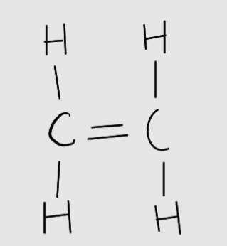
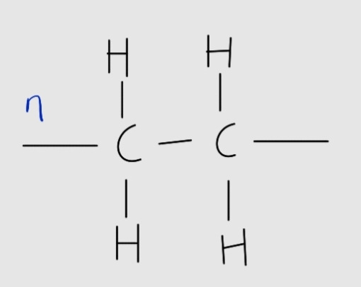
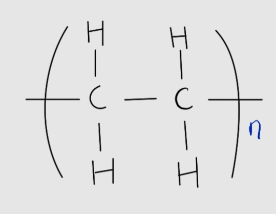
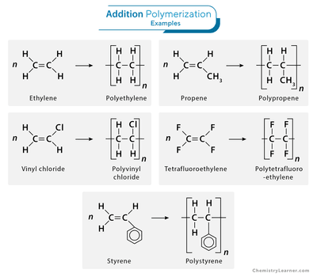

## Addition Polymers

**Polymerisation Reactions**

* Alkene molecules used in polymerisation are referred to as monomers.
* Ethene monomers form poly(ethene) or polythene
* **Monomer: the building blocks of a polymer.**

* Repeating unit: the sequence of atoms repeating in the polymer (always depicted without the double bond).

* Polymer: the ultimate product of addition polymerisation reaction and can be *n* number of chains long.

* **n represents the number of repeating units**
* While alkenes are normally drawn with 120° angles, polymer structures should be drawn with 90° angles.

* As the ratio of C:H atoms are same for a monomer and its respective polymer, both have the same empirical formula.
* Polymerisation is a process with 100% atom economy because no side products are formed.