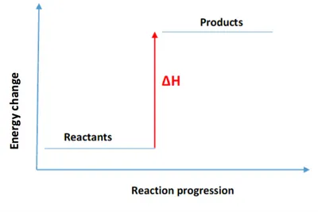
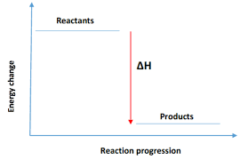

# Enthalpy and Enthalpy Changes

## Energy and Enthalpy Changes

* Energy and enthalpy are both important concepts in thermodynamics.

* In a thermodynamic system, **internal energy** is used as a general term for various kinds of energy that is used to start a system.

* Enthalpy, on the other hand, includes the internal energy of a system along with the product of pressure and volume.

* Enthalpy cannot be measured directly; only enthalpy changes, $\Delta H$, can be determined.

* Reactions can be of two types:

  * Endothermic: the products of the reaction will have higher energy than the reactants, and $\Delta H$ is positive. **Example:** thermal decomposition of $CaCO_{3}$
  * Exothermic: the products have lower energy than the reactants, and $\Delta H$ is negative. **Example**: Most neutralisation reactions are exothermic.

* Energy Level diagrams (Endothermic and Exothermic reactions, respectively):

* All chemical reactions involve both bond-making and bond-breaking processes.

* The energy needed to break the bonds of the reactants is transferred to make new bonds in the products.

* Endothermic reactions absorb energy from the surroundings, making the temperature around the drop, while exothermic reactions release energy to the surroundings.

* In conclusion, in an exothermic reaction, more energy is released when the bonds are formed in the products that is used to break the bonds in the reactants (look back at the energy level diagram), and in an endothermic reaction, more energy is absorbed when the bonds in the reactants are broken than is released when new bonds are formed in the products.

* Atomisation, ionisation and melting are **always** endothermic.