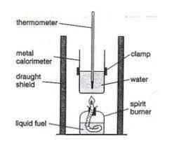

## Standard Enthalpy Change of Combustion

* The standard enthalpy change of combustion is the enthalpy measured at 100 kPa and 298 K when **one** mole of a substance is completely burned in oxygen.

### **Finding The Enthalpy Change of Combustion of a Liquid**

* **Apparatus:**
  * Draught shields are used to keep the air from the surroundings out to keep the flame stable
  * Liquid fuels can be methanol, ethanol, etc.
  * Copper cans are usually used as the vessel to hold the water.
* The apparatus shown is used to determine the enthalpy change of combustion of a liquid.
* The enthalpy change of combustion is determined by burning a known mass of liquid and using the heat energy released to heat a known volume of water.
* The initial measurements to be taken are:
  * Volume of water
  * Initial temperature displayed on thermometer
  * The initial mass of the spirit burner
* The final measurements to be taken are:
  * The final temperature is shown on the thermometer
  * The final mass of the spirit burner

### **Calculating The Enthalpy Change of Combustion**

* The formula to be used is $\Delta H=\frac{-Q}{\text{Moles}}$
  * Where $\Delta H$ is the enthalpy change
  * Where Q is the heat energy and is given in kJ
  * $\Delta H$ is given by kJ$^{-mol}$
* Q is calculated using $Q=mc\Delta T$
  * Q represents the heat energy (J)
  * m is the mass of water (g)
    * The density of water is always assumed to be $1.00 {g} \ {cm}^{-3}$, so if the volume of water is $100.0 cm^{3}$, then the mass is 100.0 g
  * c is the specific heat capacity of water ($4.18 J{g}^{-1}{k}$)
  * $\Delta T$ is the change in temperature (°K) (final temperature - initial temperature)

### **Possible Sources of Inaccuracy In The Experiment**

* Some of the heat energy produced in burning the liquid is transferred to air rather than water.
* Some of the heat energy produced in burning the liquid is transferred to the copper can than water.
* Some of the fuel may not burn completely (incomplete combustion) and forms soot.
* The conditions may not be standard.