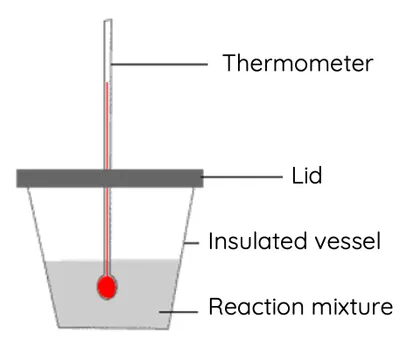

## Standard Enthalpy Change of Neutralisation

* The standard enthalpy change of neutralisation is the enthalpy measured at 100 kPa and 298 K when **one** mole of water is produced by the neutralisation of an acid with an alkali.

### **Finding The Enthalpy Change of Neutralisation**

* **Apparatus:**
  * Insulated vessels commonly used are polystyrene cups

### **Calculating The Enthalpy Change of Neutralisation**

* The same formulas used in calculating the enthalpy change of combustion are used.
* Since the initial temperatures of both acid and alkali are measured, the mean is taken to subtract from the final temperature.
* The mass of the substance heated is given by the addition of both volumes of acid and alkali (assuming the density is $1.00 {g} \ {cm}^{-3}$)
* The amount of **acid** neutralised gives the amount of water formed (remember, the standard enthalpy change of neutralisation is when **one** mole of water is formed). So, -Q is divided by the moles of acid to give the $\Delta H$ of neutralisation.