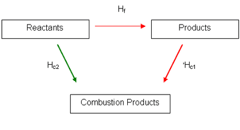
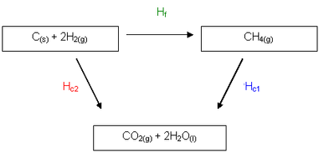
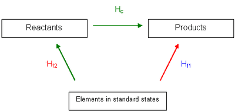
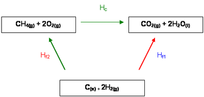

## Hess’ Law

* Hess’ Law states that the total enthalpy change is independent of the route of the chemical reaction as long as the initial and final conditions are the same.

### **Constructing Enthalpy Cycles**

**Enthalpy Change of Formation Using Combustion Data:** 

* $\Delta H_{c} = \Delta H_{1} - \Delta H_{2}$

* Example:

**Enthalpy Change of Formation Without Combustion Data:** 

* $\Delta H_{r} = \Delta H_{2} - \Delta H_{1}$

* Example:

