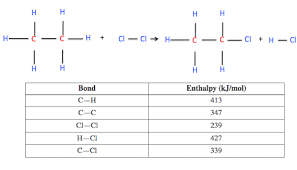

## Bond and Mean Bond Enthalpy

* Bond enthalpy is the enthalpy change when one mole of a bond in the gaseous state is broken.
* The sign for the bond enthalpy is always positive because bond breaking is an endothermic process.
* Mean bond enthalpy is the bond enthalpy when one mole of a bond averaged out over many different molecules is broken.

**When bond energies are given,**

* $\Delta H$ = bonds broken - bonds formed

* Example:

* The $\Delta H$ will be the $\Delta H$ of bonds broken in both ethane and chlorine - $\Delta H$ of bonds formed in both chloroethane and hydrochloric acid.

* $[347 + (6 \times 413) + 239] - [347 + (5 \times 413) + 339 + 427]$

* $3064 - 3178 = -114 \frac{\text{KJ}}{\text{mol}}$