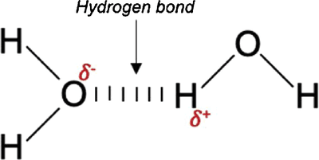

## Hydrogen Bonding

* Arises when hydrogen is bonded to another atom of a **higher** electronegativity ($F, O, N,$ etc.).
* A molecule with hydrogen bonding may or may not have permanent dipole interactions (the geometry of the molecule plays a significant role).
* It is often considered the strongest of the three forces.
* The bonding in water is a perfect example of hydrogen bonding:

 

* Molecules with hydrogen bonds usually have high boiling and melting points.

