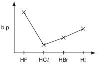

## Boiling Temperatures

* The boiling temperatures of different alkanes can depend on various factors, including the chain length and whether the structure is branched or unbranched.
* The electronegativities of carbon (2.5) and hydrogen (2.1) are very similar. Hence, there is no significant difference in the electron densities within alkanes.
* This is why London forces are the predominant forces found in alkanes without another significant functional group. The magnitude of this intermolecular force plays an important role in the boiling temperature.
* Typically, longer hydrocarbon chains and/or unbranched chains exhibit higher boiling and melting temperatures than their shorter, branched counterparts.
  * This is because the longer the chain, the more surface area or points of contact it possesses. This increases the strength of the intermolecular forces within.
  * Similarly, unbranched structures also have more points of contact.
  * Both these factors increase the London (or Van Der Waals) forces for the molecule, and a lot more energy is required to break the bonds between them.
* **2** **methylbutane** will have a lower boiling temperature than **pentane** because the former is a branched molecule.
* **2,2** **dimethylpropane** will have a lower boiling temperature than **2** **methylbutane** because the former is highly branched.
* In the case of a linear structure and a branched structure with more carbon atoms, the latter will have a higher boiling point despite not being linear.
* Cycloalkanes also generally have a higher boiling point than their straight-chained counterparts (cycloalkanes have more areas of contact).
* Alcohols have a hydroxyl ($OH$) group, and since oxygen is significantly more electronegative than hydrogen, alcohols exhibit hydrogen intermolecular forces.
* Since hydrogen forces are often considered the strongest intermolecular forces, alcohols generally show higher boiling temperatures than their alkane counterparts, regardless of the chain length or the number of branches.
  * **2 methylbutan 2 ol** will have a higher boiling temperature than $pentane$ due to the presence of hydrogen bonding, which increases the attraction within the molecule.
* Despite this, longer alkanes will have higher boiling temperatures than shorter alcohols.
  * Octane has a higher boiling temperature than methanol because the strength of London forces in octane outweighs the strength of the single hydrogen bond in methanol.
  * It is important to remember that as the chain length of the alkane increases, the increased surface area tends to outweigh the strength of the otherwise strong hydrogen forces.
* Hydrogen fluoride has the highest boiling point out of all halides because fluorine is the most electronegative atom (3.98) and, hence, forms the strongest bond.
* From hydrogen chloride to hydrogen iodide, the boiling points show a general increase.

* This is because, down the group, the atomic radius and the number of electrons increases, resulting in stronger London forces.
* $HF$ has hydrogen forces, while $HCl, HBr, HI$ only show dipole-dipole and London forces.