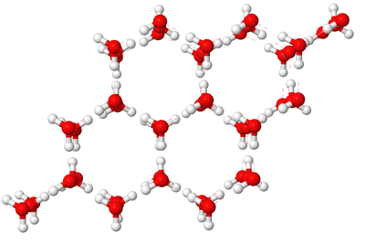

## Water

* Water, despite being a small molecule with few electrons, has a high boiling and melting temperature.
* This anomalous property can be attributed to the numerous hydrogen bonds water molecules form with each other.
* Water has a higher boiling point than hydrogen fluoride because water can form two hydrogen bonds per molecule ( $H_{2}O$) while HF only forms one.
* Water is one of the few substances whose solid form is less dense than its liquid form.
* Ice forms a hexagonal ring structure with large open “holes” in between, creating a less dense form.

 