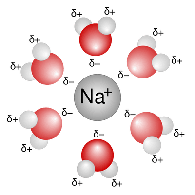

## Dissolving Substances

* Water is considered a “universal solvent” because it can dissolve several substances.

* Many ionic substances can be dissolved in water because they are polar (they have a separation of charges) and are attracted to the partial positive (H) and partial negative (O) parts of water.

  * The cations in the ionic compound are attracted to the oxygen, and the anions are attracted to the hydrogen.

* Ion-dipole interaction refers to the interaction between ions and a water molecule.

* Ion-dipole interaction is the principle behind hydration, wherein ions dissolved in a solution are surrounded by water molecules.

* The ion-dipole forces between water molecules and the ions in NaCl are stronger than the intermolecular forces between NaCl in the solid state.

  * Similarly, alkanes like hexane (non-polar) only form London forces with water, which are weaker than the existing hydrogen bonds within the water molecules. So, hexane is **not** soluble in water.

* Alcohols can also dissolve in water as their OH group can form hydrogen bonds with water molecules.

* Smaller alcohols are more soluble in water than longer chains.

  * **Example:** Methanol is more soluble in water than hexanol because of its shorter chain length, hence making it more polar.

* Non-polar molecules (like alkanes) either have limited solubility or do not dissolve in water at all.

* This can be because the attraction between the molecule and water molecules is too weak or is not sufficient enough to disrupt the hydrogen bonds between the water molecules.

* Reactions involving halogenoalkanes (insoluble in water due to the reasons above) are usually carried out using ethanol as a solvent.

* Substances with similar properties and polarity tend to dissolve in each other;  “like dissolves like”.

  * Polar substances can dissolve in polar substances.
  * Non-polar substances can dissolve in non-polar substances.