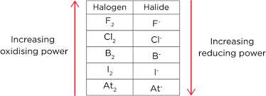
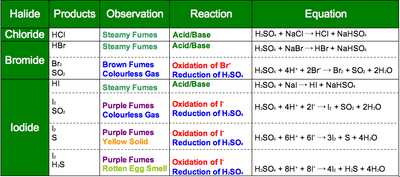

## Reactions of Halides With Sulfuric Acid

* Trend in oxidising and reducing power of group 7 elements:

* Concentrated sulfuric acid is an oxidising agent and is reduced in an equation.

* Fluorine is a bad reducing agent and cannot react with an oxidsing agent.