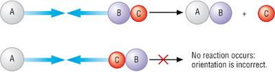
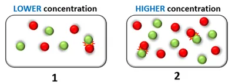
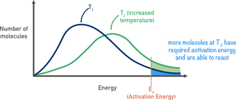
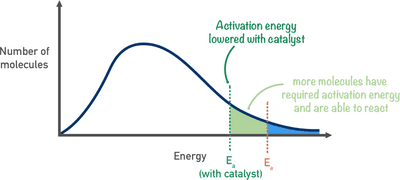

# Kinetics and Equilibria

## Kinetics

* The rate of a reaction provides information about how quickly reactants are converted into products in a chemical reaction.
* The rate of reaction is given by $\frac{\text{change in concentration}}{\text{time for change to happen}}$
* The rate of a reaction can also be found from the time taken for a known amount of reactant to be used up or a known amount of product to be formed.
* The rate of reaction is also given by $\frac{\text{volume of gas collected}}{\text{time taken}}$

### Collision Theory

* Chemical reactions occur when reactants collide with each other.

There are two factors to ensure successful collision:

* The reactants must have enough energy to overcome the activation energy.

* The reactants should also be in the correct orientation:

* When the molecules are incorrectly oriented, they simply bounce off of each other and no reaction occurs.

### Activation Energy

* Activation energy is the minimum energy required to start a chemical energy.

### Factors Affecting the Rate of Reaction

**Concentration**

* When the concentration increases, the reaction rate usually increases as the frequency of successful collisions between the reactants increases.

**Pressure**

* The increase in pressure only affects the rate of reaction when the reactants are gases.
* Increasing pressure brings the reactants together and the frequency of successful collisions increases, thus increasing the rate of reaction.

**Surface Area**

* The larger the surface area, the faster the rate of reaction.
* When solids are involved, they are often powdered to increase the surface area.

**Temperature**

* When the temperature increases, the particles involved gain greater kinetic energy.

* This increases the frequency of collision.

* Further, more molecules have energy greater than the activation energy (more molecules will thus react).

* So, the rate of reaction increases.

* The Maxwell-Boltzmann curve below shows the effect of temperature:

**Catalyst**

* Catalysts are substances that increases the rate of reaction without being used up themselves.

* They do this by providing an alternate chemical route that has a lower activation energy.

* They do not have an effect on the kinetic energy of the molecules.

* The Maxwell-Boltzmann curve below shows the effect of adding a catalyst:

* Catalysts are desired in industries as they increase the yield and reduces any waste products.

* They also reduce energy costs.

**Features of the Maxwell-Boltzmann Curve**

* The area under the curve is the total number of molecules.
* No molecules have zero energy.
* Most particles have intermediate (average) energies.
* Very few molecules have high energies.
* A high temperature shifts the curve to the right and is lower.
* A low temperature shifts the curve to the left and is higher.
* Catalysts do not have an effect on the curve, but will shift the position of the activation energy ($E_A$) to the left.