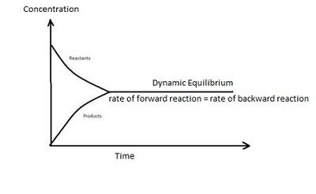

## Equilibria

* A reaction may be reversible or irreversible.
  * A reversible reaction is that which can go in the forward and backward directions simultaneously.
* At equilibrium, the concentration of reactants and products stays the same.

### Dynamic Equilibrium

* Dynamic equilibrium is when the rate of forward reaction is equal to that of the backward reaction.

### Le Chatelier’s Principles of Equilibrium

**Factors Affecting Equilibrium**

1. Concentration: when the concentration is increased, the equilibrium is always shifted from high concentration to low concentration.

   1. A + B → C + D (if A increases (conc. of reactants increase), C & D increases (conc. of products increase)

2. Pressure (only affects the equilibrium of gases):

   1. Increasing the pressure shifts the equilibrium to the side with fewer moles of gas.
   2. Decreasing the pressure shifts the equilibrium to the side with more moles of gas.
   3. Pressure has no effect when both sides have the same number of moles.

3. Temperature:

   1. Increasing the temperature increases the endothermic reaction.
   2. Decreasing the temperature decreasing the exothermic reaction.
   3. Example: If in an equilibrium, the forward reaction is exothermic while the backward reaction is endothermic, temperature increment can have contrasting effects.

4. Catalyst: **does not** have an effect on the equilibrium position but does help reach the equilibrium faster.