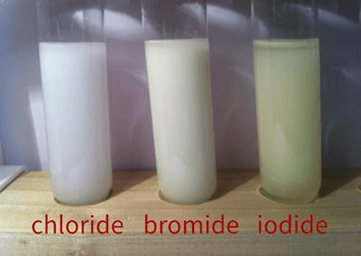

# Halogenoalkanes, Alcohols and Spectra

## Halogenoalkanes

* Halogenoalkanes are a homologous series of compounds with the general formula $C_{n}H_{2n+1}X$, where X is a halogen atom (F, Cl, Br…).
* Examples of halogenoalkanes include tetrafluoromethane, 1,2-dichloropropane, etc.
* Similar to carbocations, halogenoalkanes can also be classified into primary, secondary and tertiary.
  * Primary halogenoalkanes are those whose halogen atom are attached to one alkyl group, like chlorobutane.
  * Secondary halogenoalkanes are those whose halogen atom is attached to two alkyl groups, like 2-chloropropane.
  * Tertiary halogenoalkanes are those whose halogen atom is attached to three alkyl groups, like 2-chloro-2-methylpropane
* The C—X bond is always polar because the electronegativity of the halogens is always greater than that of carbon.
* Nucleophiles are species with either a negative charge or a lone pair, they are literally nucleus-loving.

### Comparing the Rates of Hydrolysis Reactions

* Hydrolysis reactions are those in which water or hydroxide ions replace an atom in a molecule with an -OH group.
* The rate of hydrolysis reactions for different halogenoalkanes (chloro-, bromo-, iodo-) can be investigated using silver nitrate and nitric acid.
* $Ag^{+} + X^{-} \rightarrow AgX$
* By observing how quickly the precipitate (AgX) forms, we can tell how quickly the reaction occurs.

* AgI gives a yellow precipitate the fastest because the C—I bond enthalpy is the weakest (electronegativity decreases down the group).

* AgBr gives a cream precipitate

* AgCl gives a white precipitate the slowest because the C-Cl bond enthalpy is the strongest out of all.

* Similarly, the structure of the halogenoalkane also has an effect as tertiary halogenoalkanes react the fastest and primary halogenoalkanes react the slowest.