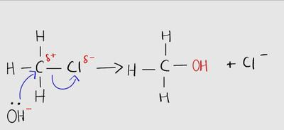
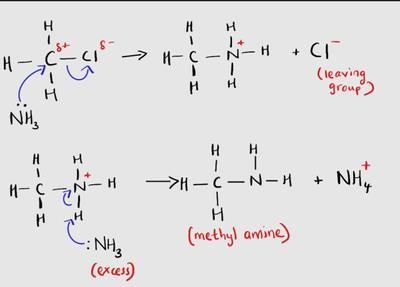

## Mechanism of Nucleophilic Substitution Reaction

$$

CH_{3}Cl + KOH \rightarrow CH_{3}OH + Cl^{-}

$$

* Here, $OH^{-}$ acts as the nucleophile and attacks the partial positive C atom in the C—Cl bond.

* **Mechanism**:

The reaction with $NH_3$ is a little different as it is carried out in steps:

* $CH_{3}Cl + NH_{3} \rightarrow CH_{3}NH_{2} + HCl$

* $CH_{3}NH_{2} + HCl \rightarrow CH_{3}NH_{3}^{+} + Cl^{-}$

* $CH_{3}NH_{3}^{+} Cl^{-} + NH_{3} \rightarrow CH_{3}NH_{2} + NH_{4}Cl$

* The ammonia used should be ethanolic.

* Acids are proton donors while bases are proton acceptors.

* $NH_3$ is the nucleophile but is changed to $NH_2$, with H being the side product.

* In the second step, the amine and Cl are attracted to each other due to the opposite signs.

* The amine in the first and last step will be identical (because they are simply reproduced).

* **Mechanism**:

* Note that the mechanism does not display all the steps in the equation.