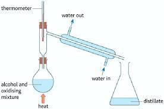
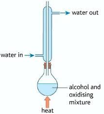

## Alcohols

* Alcohols are homologous series of compounds with the general formula $C_{n}H_{2n+1}OH$
* Similar to carbocations and halogenoalkanes, alcohols can also be classified as primary, secondary and tertiary:
  * Butanol is a primary alcohol.
  * Butan-2-ol is a secondary alcohol.
  * 2-methylpropan-2-ol is a tertiary alcohol.

### Reactions of Alcohols

Typical reactions of alcohols:

* **Combustion** - $CH_{3}CH_{2}OH + 3O_{2} \rightarrow 2CO_{2} + 3H_{2}O$

* **With sodium** - $2CH_{3}CH_{2}OH + 2Na \rightarrow 2CH2CH2ONa + H_{2}$

* **Dehydration** - $CH_{3}CH_{2}CH_{2}OH \rightarrow CH3CHCH_{2} + H_{2}O$

  * Conditions: heat, conc. $H_{3}PO_{4}$ as a catalyst

* **Halogenation** -

  * **Chlorination**: $CH_{3}CH_{2}OH + PCl_{5} \rightarrow CH_{3}CH_{2}Cl + POCl_{3} + HCl$, conditions: room temperature

  * **Bromination**: 1. [50% conc. $H_{2}SO_{4}$] $KBr + H_{2}SO_{4} \rightarrow K_{2}SO_{4} + HBr 2. CH_{3}CH_{2}OH + HBr \rightarrow CH_{3}CH_{2}Br + H_2O$, conditions: heat under reflux

  * Iodination: 1. $2P + 3I_{2} \rightarrow 2PI_{3} 2. CH_{3}CH_{2}OH + PI_{3} \rightarrow CH_{3}CH_{2}I + H_{3}PO_{3}$

* Chlorination of alcohols is used as a test for checking the presence of hydroxyl (OH) group as HCl produces musty fumes.

* Oxidation of alcohols:

  * Primary alcohols are oxidised to aldehydes (RCHO), which is further oxidised to carboxylic acids (R-COOH) when heated under reflux.
  * Secondary alcohols are oxidised to ketones (RCOR) , which cannot be further oxidised.
  * Tertiary alcohols cannot be oxidised.
  * The oxidising mixture commonly used is $K_{2}Cr_{2}O_{7}$ and $H_{2}SO_{4}$

* The apparatus used to oxidise a primary alcohol to an aldehyde is a distillation apparatus:

* This apparatus oxidises the primary alcohol incompletely, thus distilling off the aldehyde formed.

* If further oxidation is desired, then a heat under reflux apparatus is used:

* In this apparatus, the aldehyde formed is condensed and returned back to the mixture to ensure complete oxidation into carboxylic acid.