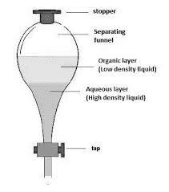

## Solvent Extraction

* When mixed with water (or any other aqueous compound), organic compounds, being immiscible, will form a layer on top.

* This apparatus is used to separate organic compounds as:

  * The tap can be opened to let the aqueous layer runoff.
  * The organic layer can then be collected.