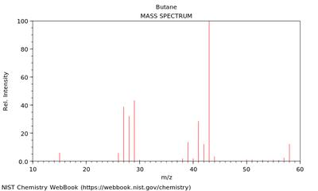
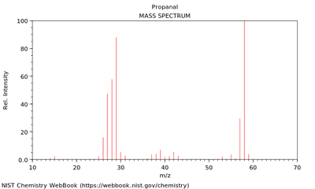
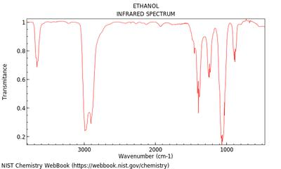
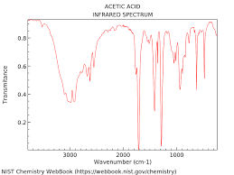

## Mass and IR Spectra

### Mass Spectra

* Mass spectrum makes uses of fragmentation which is when the molecular ion breaks into smaller pieces, which are detected in the mass spectrum.

**The mass spectrum of butane is:**

* The structural formula of butane is $CH_{3}CH_{2}CH_{2}CH_{3}$
* The tallest peak (at 43) is called the **base peak** and is the most abundant.
* The furthest peak (at 58) is called the molecular ion peak and is the most stable.
* When passed through the mass spectrometer, an ion and a fragment of the sample will be formed.

The details of the peaks and fragments:

*  15 m/z, 

  * cation: $CH_{3}^{+}$

  * lost fragment: $CH_{3}CH_{2}CH_{2}^{\bullet}$

* 29 m/z,

  * cation: $CH_{3}CH_{2}^{+}$

  * lost fragment: $CH_{3}CH_{2}^{\bullet}$

* 43 m/z,

  * cation: $CH_{3}CH_{2}CH_{2}^{+}$

  * lost fragment: $CH_{3}^{\bullet}$

* 58 m/z,

  * cation: $CH_{3}CH_{2}CH_{2}CH_{3}^{+}$

**Mass spectra of propanal:**

* propanal

* 29 m/z, cation: $CHO^{+}$
* 57 m/z, cation: $CH_{3}CH_{2}CO^{+}$
* 58 m/z, cation: $CH_{3}CH_{2}CHO^{+}$

### Infrared Spectra

* When molecules absorb infrared radiation, they vibrate by either stretching or bending.
* Different bonds require different amounts of energy for vibration.
* Common peaks:

|Wavenumber/ cm^-|Bond|Functional Group|
|:---|:---|:---|
|1000-1300|C-O stretching|alcohols, esters, acids|
|1680-1740|C=O stretching|aldehyde, ketones, carboxylic acid|
|2500-3300|O-H stretching|carboxylic acids|
|2850-3000|C-H stretching|alkanes|
|3200-3750|O-H stretching|alcohols|

The infrared spectrum of ethanol is shown below:

* Each peak is unique to the vibration of one particular group.
* The sharper the peak, the more prominent the bond is.
* Example: in the IR spectrum shown, there is a sharp peak at 3200-3750 due to the OH stretching.

**Identifying an Unknown Compound Using IR**

* A molecule with formula $C_{2}H_{4}O_{2}$ has an IR spectrum as shown:

* To identify the molecule, we study the peaks.
* From the spectrum, the sharp peak at 1680-1740 can be attribute to C=O stretching.
* Further, there is a peak at 2500-3300 which is a characteristic of O-H stretching in carboxylic acid.
* Both observations suggest that the molecule in question is ethanoic acid ($CH_3COOH$)