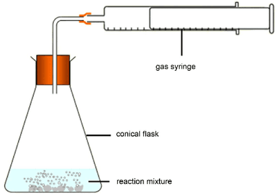
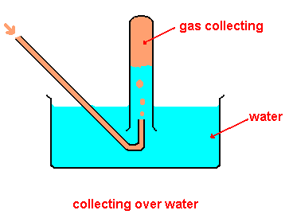

# Finding The Molar Volume of a Gas

**Method**:

* Measure 30 $cm^3$ of ethanoic acid and transfer it to a conical flask.
* Measure the mass of a test tube with approximately 0.05 g of calcium carbonate.
* Add the calcium carbonate to the conical flask quickly, sealing the bung so that no gas escapes.

Measure and record the volume of carbon dioxide gas produced using one of two methods:

* Using a gas syringe

* Collection over water

* Reweigh the test tube

* Repeat the experiment by increasing the mass of calcium carbonate by 0.05 g successively.