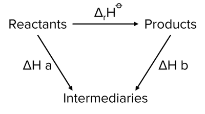

# Determine the Enthalpy Change of a Reaction Using Hess's Law

**Method**:

* Place a polystyrene cup in a beaker for both insulation and support.

* Using a pipette, transfer desired volume of hydrochloric acid (or other solution) to the cup.

* Place a thermometer in the cup and measure the initial temperature of the solution.

* Potassium carbonate (or other solid reagent) should be added to the cup after the test tube with the solid is weighed using a balance.

* Stir the mixture and record the temperature every minute for several minutes.

* The empty test tube should be reweighed.

* Th experiment should then be repeated using potassium hydrogencarbonate and the lowest temperature reached should be recorded.

