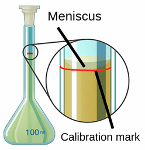

# Standard Solution

## Preparation

When you're asked to prepare a standard solution of a pre-weighed solid with a given mass, follow the steps below:

* Dissolve the solid in a beaker with distilled water. The amount of water added depends on the desired concentration of the standard solution.
* Stir the mixture using a glass rod until all the solid is dissolved in the water.
* Using a funnel, transfer the solution to a volumetric flask.
* After transferring, wash the beaker with distilled water and transfer these washings to the volumetric flask.
* Using a pipette, continue adding distilled water to the volumetric flask until the bottom of the meniscus is up to the mark.
* Close the volumetric flask using a stopper and keep inverting and shaking it to mix the solution.

 